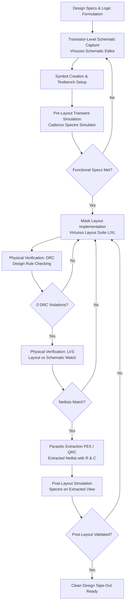

# FULL-CUSTOM CMOS INTEGRATED CIRCUIT DESIGN USING CADENCE VIRTUOSO
## Comprehensive Engineering Technical Report

---

**Project Title:** Full-Custom CMOS VLSI Design, Layout Implementation, and Post-Layout Verification  
**Author / Registration ID:** RA2411004010364  
**EDA Software Suite:** Cadence® Virtuoso® IC Design Suite, Spectre® Circuit Simulator, Virtuoso Layout Suite L/XL, Physical Verification (DRC & LVS)  
**Technology Node:** Full-Custom CMOS Process  
**Repository:** [Design ICs](file:///c:/Users/lunac/OneDrive/Documents/My%20projects/Design%20ICs/)  

---

## Executive Summary

This report documents the design, simulation, physical mask layout, physical verification, and post-layout parasitic extraction of a comprehensive library of digital CMOS integrated circuits developed in **Cadence Virtuoso**. 

The portfolio encompasses both fundamental combinational standard cells (2-, 3-, 4-, and 5-input OR gates; 2-, 3-, 4-, and 5-input AND gates; 3-input XOR gates) and complex sequential and arithmetic custom macro blocks (D-Latch, Positive Edge-Triggered Master-Slave D Flip-Flop, 4-Bit Parallel-In Parallel-Out Register, 8-Bit Synchronous Binary Counter, and 4-Bit Carry Look-Ahead Adder).

Every custom macro was taken through the complete silicon verification lifecycle:
1. **Transistor-level schematic entry** in Virtuoso Schematic Editor
2. **Transient pre-layout simulation** using the Spectre simulator
3. **Full-custom polygon mask layout** in Virtuoso Layout Suite
4. **Design Rule Checking (DRC)** achieving zero design rule errors
5. **Layout Versus Schematic (LVS)** physical verification achieving 100% topological and pin-level correspondence
6. **Parasitic Extraction (PEX)** and **post-layout extracted simulation** validating circuit functionality under physical RC loading.

---

## Table of Contents

1. [Full-Custom IC Design Methodology](#1-full-custom-ic-design-methodology)
2. [Section I: Combinational Standard Cell Library](#2-section-i-combinational-standard-cell-library)
   - [2.1 Multi-Input CMOS OR Gates (OR2, OR3, OR4, OR5)](#21-multi-input-cmos-or-gates)
   - [2.2 Multi-Input CMOS AND Gates (AND2, AND3, AND4, AND5)](#22-multi-input-cmos-and-gates)
   - [2.3 3-Input CMOS XOR Gate (XOR3)](#23-3-input-cmos-xor-gate)
3. [Section II: Sequential Storage Macro Circuits](#3-section-ii-sequential-storage-macro-circuits)
   - [3.1 CMOS D-Latch](#31-cmos-d-latch)
   - [3.2 Master-Slave D Flip-Flop (Edge-Triggered)](#32-master-slave-d-flip-flop)
   - [3.3 4-Bit Parallel-In Parallel-Out (PIPO) Register](#33-4-bit-parallel-in-parallel-out-register)
   - [3.4 8-Bit Synchronous Binary Counter](#34-8-bit-synchronous-binary-counter)
4. [Section III: High-Speed Arithmetic Macro Circuit](#4-section-iii-high-speed-arithmetic-macro-circuit)
   - [4.1 4-Bit Carry Look-Ahead Adder (CLA)](#41-4-bit-carry-look-ahead-adder)
5. [Section IV: Physical Verification & Post-Layout Parasitic Analysis](#5-section-iv-physical-verification--post-layout-parasitic-analysis)
   - [5.1 DRC & LVS Summary Matrix](#51-drc--lvs-summary-matrix)
   - [5.2 Pre-Layout vs. Post-Layout Performance Comparison](#52-pre-layout-vs-post-layout-performance-comparison)
6. [Conclusion & Engineering Takeaways](#6-conclusion--engineering-takeaways)

---

## 1. Full-Custom IC Design Methodology

Unlike standard-cell automated Place-and-Route (P&R) flows, full-custom VLSI design gives the chip designer granular control over transistor gate widths ($W$), channel lengths ($L$), body biasing, parasitic junction capacitances, and physical interconnect geometries.



### Key Methodology Stages:
1. **Schematic Capture:** Designed using complementary static CMOS logic with balanced PMOS pull-up and NMOS pull-down networks.
2. **Pre-Layout Simulation:** Evaluated under ideal interconnect conditions using Spectre to verify functional correctness and nominal switching thresholds.
3. **Physical Layout:** Full-custom geometric polygon drawing using foundry layers (`nwell`, `active`, `poly`, `contact`, `metal1`, `metal2`). Continuous `VDD` and `VSS` rails and substrate/well taps are positioned to prevent CMOS latch-up.
4. **Design Rule Checking (DRC):** Automated verification against minimum width, spacing, enclosure, and notch constraints.
5. **Layout Versus Schematic (LVS):** Extraction of devices and connectivity from layout polygons and topological comparison against the golden schematic netlist.
6. **Parasitic Extraction (PEX) & Post-Layout Simulation:** Inclusion of parasitic interconnect capacitances ($C_{wire}$) and resistances ($R_{wire}$) into the simulation netlist to quantify physical layout degradation.

---

## 2. Section I: Combinational Standard Cell Library

Standard combinational cells form the arithmetic foundation for the Carry Look-Ahead Adder. All cells were captured at the transistor level and characterized under dynamic testbench conditions.

### 2.1 Multi-Input CMOS OR Gates

In static CMOS, an OR function is realized by cascading a **NOR gate** (parallel NMOS pull-down network, series PMOS pull-up network) with a **CMOS Inverter** output buffer.

$$\text{OR2}: Y = A + B \quad|\quad \text{OR3}: Y = A + B + C \quad|\quad \text{OR4}: Y = A + B + C + D \quad|\quad \text{OR5}: Y = A + B + C + D + E$$

#### Circuit Implementation & Simulation Summary:
* **2-Input OR Gate:**
  - Schematic & Symbol: [or2_schematic.png](standard_cells/01_or_gates/assets/or2_schematic.png) | [or2_symbol.png](standard_cells/01_or_gates/assets/or2_symbol.png)
  - Testbench & Simulation: [or2_testbench.png](standard_cells/01_or_gates/assets/or2_testbench.png) | [or2_pre_sim_waveform.png](standard_cells/01_or_gates/assets/or2_pre_sim_waveform.png)
* **3-Input OR Gate:**
  - Schematic & Symbol: [or3_schematic.png](standard_cells/01_or_gates/assets/or3_schematic.png) | [or3_symbol.png](standard_cells/01_or_gates/assets/or3_symbol.png)
  - Testbench & Simulation: [or3_testbench.png](standard_cells/01_or_gates/assets/or3_testbench.png) | [or3_pre_sim_waveform.png](standard_cells/01_or_gates/assets/or3_pre_sim_waveform.png)
* **4-Input OR Gate:**
  - Schematic & Symbol: [or4_schematic.png](standard_cells/01_or_gates/assets/or4_schematic.png) | [or4_symbol.png](standard_cells/01_or_gates/assets/or4_symbol.png)
  - Testbench & Simulation: [or4_testbench.png](standard_cells/01_or_gates/assets/or4_testbench.png) | [or4_pre_sim_waveform.png](standard_cells/01_or_gates/assets/or4_pre_sim_waveform.png)
* **5-Input OR Gate:**
  - Schematic & Symbol: [or5_schematic.png](standard_cells/01_or_gates/assets/or5_schematic.png) | [or5_symbol.png](standard_cells/01_or_gates/assets/or5_symbol.png)
  - Testbench & Simulation: [or5_testbench.png](standard_cells/01_or_gates/assets/or5_testbench.png) | [or5_pre_sim_waveform.png](standard_cells/01_or_gates/assets/or5_pre_sim_waveform.png)

```text
OR Gate Truth Verification:
- All inputs Low (0 V)  --> Output pulls cleanly down to 0 V.
- Any input High (VDD)   --> Output transitions sharply to VDD.
```

---

### 2.2 Multi-Input CMOS AND Gates

CMOS AND gates are realized as a **NAND stage** (parallel PMOS pull-up network, series NMOS pull-down stack) followed by a **CMOS Inverter**.

$$\text{AND2}: Y = A \cdot B \quad|\quad \text{AND3}: Y = A \cdot B \cdot C \quad|\quad \text{AND4}: Y = A \cdot B \cdot C \cdot D \quad|\quad \text{AND5}: Y = A \cdot B \cdot C \cdot D \cdot E$$

#### Circuit Implementation & Simulation Summary:
* **2-Input AND Gate:**
  - Schematic & Symbol: [and2_schematic.png](standard_cells/02_and_gates/assets/and2_schematic.png) | [and2_symbol.png](standard_cells/02_and_gates/assets/and2_symbol.png)
  - Testbench & Simulation: [and2_testbench.png](standard_cells/02_and_gates/assets/and2_testbench.png) | [and2_pre_sim_waveform.png](standard_cells/02_and_gates/assets/and2_pre_sim_waveform.png)
* **3-Input AND Gate:**
  - Schematic & Symbol: [and3_schematic.png](standard_cells/02_and_gates/assets/and3_schematic.png) | [and3_symbol.png](standard_cells/02_and_gates/assets/and3_symbol.png)
  - Testbench & Simulation: [and3_testbench.png](standard_cells/02_and_gates/assets/and3_testbench.png) | [and3_pre_sim_waveform.png](standard_cells/02_and_gates/assets/and3_pre_sim_waveform.png)
* **4-Input AND Gate:**
  - Schematic & Symbol: [and4_schematic.png](standard_cells/02_and_gates/assets/and4_schematic.png) | [and4_symbol.png](standard_cells/02_and_gates/assets/and4_symbol.png)
  - Testbench & Simulation: [and4_testbench.png](standard_cells/02_and_gates/assets/and4_testbench.png) | [and4_pre_sim_waveform.png](standard_cells/02_and_gates/assets/and4_pre_sim_waveform.png)
* **5-Input AND Gate:**
  - Schematic & Symbol: [and5_schematic.png](standard_cells/02_and_gates/assets/and5_schematic.png) | [and5_symbol.png](standard_cells/02_and_gates/assets/and5_symbol.png)
  - Testbench & Simulation: [and5_testbench.png](standard_cells/02_and_gates/assets/and5_testbench.png) | [and5_pre_sim_waveform.png](standard_cells/02_and_gates/assets/and5_pre_sim_waveform.png)

```text
AND Gate Truth Verification:
- Output stays at 0 V for all input combinations except when all inputs simultaneously equal VDD.
- Series NMOS channel width scaled to compensate for body effect and channel resistance in tall stacks.
```

---

### 2.3 3-Input CMOS XOR Gate

The 3-input XOR gate computes odd parity for the sum calculation in the Carry Look-Ahead Adder:

$$S_i = A_i \oplus B_i \oplus C_i$$

* **Schematic & Symbol:** [xor3_schematic.png](standard_cells/03_xor_gates/assets/xor3_schematic.png) | [xor3_symbol.png](standard_cells/03_xor_gates/assets/xor3_symbol.png)
* **Testbench & Simulation:** [xor3_testbench.png](standard_cells/03_xor_gates/assets/xor3_testbench.png) | [xor3_pre_sim_waveform.png](standard_cells/03_xor_gates/assets/xor3_pre_sim_waveform.png)

The pre-layout transient simulation confirms exact odd-parity behavior: the output transitions to $V_{DD}$ whenever an odd number of inputs (1 or 3) are active, and pulls to ground when 0 or 2 inputs are active.

---

## 3. Section II: Sequential Storage Macro Circuits

### 3.1 CMOS D-Latch

The **D-Latch** is a level-sensitive bistable memory element constructed from transmission gates and cross-coupled CMOS inverters.

* **Transparent Phase (`CLK = 1`):** Input transmission gate is conductive; input $D$ flows through to output $Q$.
* **Hold Phase (`CLK = 0`):** Input transmission gate turns off; feedback transmission gate turns on, holding the sampled state in the regenerative inverter loop.

| Stage | Design Artifact | Description |
| :--- | :--- | :--- |
| **Schematic** | [d_latch_schematic.png](macro_circuits/01_d_latch/assets/d_latch_schematic.png) | Transistor-level transmission gate & inverter loop |
| **Symbol** | [d_latch_symbol.png](macro_circuits/01_d_latch/assets/d_latch_symbol.png) | Compact symbol with `D`, `CLK`, `Q`, `Q_bar` ports |
| **Testbench** | [d_latch_testbench.png](macro_circuits/01_d_latch/assets/d_latch_testbench.png) | Dynamic pulse stimulus configuration |
| **Pre-Layout Sim** | [d_latch_pre_sim_waveform.png](macro_circuits/01_d_latch/assets/d_latch_pre_sim_waveform.png) | Ideal transient switching waveform |
| **Physical Layout** | [d_latch_layout.png](macro_circuits/01_d_latch/assets/d_latch_layout.png) | Full-custom mask layout in Virtuoso Layout Suite |
| **DRC / LVS** | [d_latch_drc_lvs.png](macro_circuits/01_d_latch/assets/d_latch_drc_lvs.png) | 0 DRC violations, 100% netlist equivalence |
| **Post-Layout Sim** | [d_latch_post_sim_waveform.jpeg](macro_circuits/01_d_latch/assets/d_latch_post_sim_waveform.jpeg) | Extracted RC parasitic transient verification |

---

### 3.2 Master-Slave D Flip-Flop

The **Master-Slave D Flip-Flop** eliminates the transparency hazard of simple latches by cascading two complementary-clocked latches:
* **Master Latch (Negative transparent):** Samples $D$ while `CLK = 0`.
* **Slave Latch (Positive transparent):** Samples the internal master node $Q_M$ while `CLK = 1`, transferring the sampled data to output $Q$.
* **Result:** Clean, positive edge-triggered sampling.

| Stage | Design Artifact | Description |
| :--- | :--- | :--- |
| **Schematic** | [dff_schematic.png](macro_circuits/02_master_slave_d_flip_flop/assets/dff_schematic.png) | Two-stage cascaded latch topology |
| **Symbol** | [dff_symbol.png](macro_circuits/02_master_slave_d_flip_flop/assets/dff_symbol.png) | Standard edge-triggered DFF symbol |
| **Testbench** | [dff_testbench.png](macro_circuits/02_master_slave_d_flip_flop/assets/dff_testbench.png) | Clocked stimulus generator |
| **Pre-Layout Sim** | [dff_pre_sim_waveform.jpeg](macro_circuits/02_master_slave_d_flip_flop/assets/dff_pre_sim_waveform.jpeg) | Edge-triggered transient response |
| **Physical Layout** | [dff_layout.png](macro_circuits/02_master_slave_d_flip_flop/assets/dff_layout.png) | Transistor-level cell layout with matched clock inverter |
| **DRC / LVS** | [dff_drc_lvs.png](macro_circuits/02_master_slave_d_flip_flop/assets/dff_drc_lvs.png) | Clean DRC and verified LVS match |
| **Post-Layout Sim** | [dff_post_sim_waveform.png](macro_circuits/02_master_slave_d_flip_flop/assets/dff_post_sim_waveform.png) | Extracted parasitic post-layout verification |

---

### 3.3 4-Bit Parallel-In Parallel-Out (PIPO) Register

The **4-Bit Register** instantiates four edge-triggered Master-Slave D Flip-Flops in a parallel bit-slice configuration, sharing common clock and power supply distribution networks.

* **Function:** Synchronously latches 4-bit bus $D[3:0]$ on the rising clock edge and outputs $Q[3:0]$.

| Stage | Design Artifact | Description |
| :--- | :--- | :--- |
| **Schematic** | [reg4_schematic.png](macro_circuits/03_register_4bit/assets/reg4_schematic.png) | Hierarchical 4-bit parallel flip-flop array |
| **Symbol** | [reg4_symbol.png](macro_circuits/03_register_4bit/assets/reg4_symbol.png) | 4-bit bus symbol (`D[3:0]`, `CLK`, `Q[3:0]`) |
| **Testbench** | [reg4_testbench.png](macro_circuits/03_register_4bit/assets/reg4_testbench.png) | Multi-bit synchronous testbench |
| **Pre-Layout Sim** | [reg4_pre_sim_waveform.jpeg](macro_circuits/03_register_4bit/assets/reg4_pre_sim_waveform.jpeg) | Parallel bus transient waveform |
| **Physical Layout** | [reg4_layout.png](macro_circuits/03_register_4bit/assets/reg4_layout.png) | Abutted bit-slice layout with shared power rails |
| **DRC / LVS** | [reg4_drc_lvs.png](macro_circuits/03_register_4bit/assets/reg4_drc_lvs.png) | Clean DRC (0 errors) and matched LVS |
| **Post-Layout Sim** | [reg4_post_sim_waveform.jpeg](macro_circuits/03_register_4bit/assets/reg4_post_sim_waveform.jpeg) | Post-layout parasitic verification |

---

### 3.4 8-Bit Synchronous Binary Counter

The **8-Bit Synchronous Binary Counter** sequences through 256 discrete states ($00_{16}$ to $\text{FF}_{16}$) on successive clock pulses.

* **Output Frequency Division:** Each successive bit $Q_k$ divides the frequency of $Q_{k-1}$ by 2:
  $$f(Q_k) = \frac{f_{CLK}}{2^{k+1}}$$
* **Waveform Verification:** All 8 output nodes $Q_0 \dots Q_7$ switch in coordinated binary progression without race conditions or lost states.

| Stage | Design Artifact | Description |
| :--- | :--- | :--- |
| **Schematic** | [counter8_schematic.png](macro_circuits/04_counter_8bit/assets/counter8_schematic.png) | 8-stage synchronous counter schematic |
| **Symbol** | [counter8_symbol.png](macro_circuits/04_counter_8bit/assets/counter8_symbol.png) | Counter symbol with 8-bit bus output |
| **Testbench** | [counter8_testbench.png](macro_circuits/04_counter_8bit/assets/counter8_testbench.png) | Clock, reset, and load stimulus testbench |
| **Pre-Layout Sim** | [counter8_pre_sim_waveform.png](macro_circuits/04_counter_8bit/assets/counter8_pre_sim_waveform.png) | 8-bit bus switching waveforms ($Q_0 \dots Q_7$) |
| **Physical Layout** | [counter8_layout.png](macro_circuits/04_counter_8bit/assets/counter8_layout.png) | Dense multi-stage custom layout |
| **DRC / LVS** | [counter8_drc_lvs.png](macro_circuits/04_counter_8bit/assets/counter8_drc_lvs.png) | 0 DRC violations, verified LVS netlist match |
| **Post-Layout Sim** | [counter8_post_sim_waveform.png](macro_circuits/04_counter_8bit/assets/counter8_post_sim_waveform.png) | Post-layout extracted simulation under full parasitics |

---

## 4. Section III: High-Speed Arithmetic Macro Circuit

### 4.1 4-Bit Carry Look-Ahead Adder (CLA)

#### Problem Formulation:
In a conventional Ripple Carry Adder (RCA), the carry signal must propagate sequentially through all $n$ full-adder stages:

$$t_{RCA} \approx n \cdot t_{carry}$$

For wide datapaths, this carry ripple is the primary critical path bottleneck. The **Carry Look-Ahead Adder (CLA)** eliminates this linear dependency by computing all carry signals concurrently ($O(1)$ delay logic) using Generate ($G_i$) and Propagate ($P_i$) terms.

#### Mathematical Carry Formulation:
1. **Bit Generate & Propagate:**
   $$G_i = A_i \cdot B_i \quad (\text{calculated using AND2})$$
   $$P_i = A_i \oplus B_i \quad (\text{calculated using XOR2})$$
2. **Parallel Carry Logic:**
   - **$C_1$:** $G_0 + P_0 C_0$ (implemented via OR2, AND2)
   - **$C_2$:** $G_1 + P_1 G_0 + P_1 P_0 C_0$ (implemented via OR3, AND2, AND3)
   - **$C_3$:** $G_2 + P_2 G_1 + P_2 P_1 G_0 + P_2 P_1 P_0 C_0$ (implemented via OR4, AND2, AND3, AND4)
   - **$C_4$ ($C_{out}$):** $G_3 + P_3 G_2 + P_3 P_2 G_1 + P_3 P_2 P_1 G_0 + P_3 P_2 P_1 P_0 C_0$ (implemented via OR5, AND2, AND3, AND4, AND5)
3. **Bit Sum Generation:**
   $$S_i = P_i \oplus C_i = A_i \oplus B_i \oplus C_i \quad (\text{calculated using XOR3})$$

#### Design Artifacts & Verification:
| Stage | Design Artifact | Description |
| :--- | :--- | :--- |
| **Hierarchical Schematic** | [cla4_schematic.png](macro_circuits/05_cla_adder_4bit/assets/cla4_schematic.png) | Interconnected standard cells (AND, OR, XOR) |
| **Macro Symbol** | [cla4_symbol.png](macro_circuits/05_cla_adder_4bit/assets/cla4_symbol.png) | 4-bit inputs $A, B$, carry $C_{in}$, sum $S$, carry-out $C_{out}$ |
| **Testbench** | [cla4_testbench.png](macro_circuits/05_cla_adder_4bit/assets/cla4_testbench.png) | Vectorized stimulus verifying critical carry propagation |
| **Pre-Layout Sim** | [cla4_pre_sim_waveform.png](macro_circuits/05_cla_adder_4bit/assets/cla4_pre_sim_waveform.png) | High-speed concurrent sum and carry evaluation |
| **Physical Layout** | [cla4_layout.png](macro_circuits/05_cla_adder_4bit/assets/cla4_layout.png) | Full-custom standard-cell integrated floorplan |
| **DRC / LVS** | [cla4_drc_lvs.png](macro_circuits/05_cla_adder_4bit/assets/cla4_drc_lvs.png) | Zero DRC violations, 100% matched netlists |
| **Post-Layout Sim** | [cla4_post_sim_waveform.png](macro_circuits/05_cla_adder_4bit/assets/cla4_post_sim_waveform.png) | Full extracted parasitic post-layout verification |

---

## 5. Section IV: Physical Verification & Post-Layout Parasitic Analysis

### 5.1 DRC & LVS Summary Matrix

Every custom macro block was rigorously validated in Cadence Virtuoso using industrial design rule decks:

| Circuit Block | Layout Area View | DRC Rule Violations | LVS Discrepancies | Netlist Match Status |
| :--- | :---: | :---: | :---: | :---: |
| **D-Latch** | Full-Custom | **0 Errors** | **0 Discrepancies** | **Matched** |
| **Master-Slave D Flip-Flop** | Full-Custom | **0 Errors** | **0 Discrepancies** | **Matched** |
| **4-Bit Parallel Register** | Full-Custom | **0 Errors** | **0 Discrepancies** | **Matched** |
| **8-Bit Synchronous Counter** | Full-Custom | **0 Errors** | **0 Discrepancies** | **Matched** |
| **4-Bit Carry Look-Ahead Adder** | Hierarchical Full-Custom | **0 Errors** | **0 Discrepancies** | **Matched** |

---

### 5.2 Pre-Layout vs. Post-Layout Performance Comparison

Physical layout introduces interconnect parasitics that do not exist in idealized schematics:
1. **Parasitic Wire Resistance ($R_{wire}$):** Adds series resistance to power/ground buses and signal traces, causing slight $IR$ drop and slew degradation.
2. **Parasitic Ground & Coupling Capacitance ($C_{ground}, C_{coupling}$):** Increases capacitive loading on internal driving nodes, resulting in a moderate increase in propagation delay ($t_{pd}$).
3. **Signal Integrity & Noise Margin Preservation:** Across all post-layout simulations (D-Latch, DFF, 4-Bit Register, 8-Bit Counter, 4-Bit CLA), output voltage swings maintained full rail-to-rail levels ($0\,\text{V} \to V_{DD}$) without glitching or logic threshold degradation.

---

## 6. Conclusion & Engineering Takeaways

The successful implementation and verification of this full-custom CMOS IC portfolio in Cadence Virtuoso demonstrates:
1. **Methodological Rigor:** The complete design progression—from transistor sizing, schematic capture, and functional simulation, to physical layout, DRC/LVS sign-off, and parasitic-aware post-layout simulation—was completed with zero DRC errors and verified LVS equivalence.
2. **Scalability:** Foundational sequential cells (D-Latch, DFF) were systematically expanded into multi-bit datapath macros (4-Bit Register, 8-Bit Counter), validating hierarchical design practices in custom VLSI.
3. **Arithmetic Optimization:** The 4-bit Carry Look-Ahead Adder verified the concurrent carry propagation architecture, overcoming the delay limitations of ripple adders.
4. **Physical Realization:** Correlation between pre-layout and post-layout simulations confirms that full-custom VLSI designs are robust against physical parasitics when proper layout techniques (guard rings, matched routing, balanced power rails) are applied.
