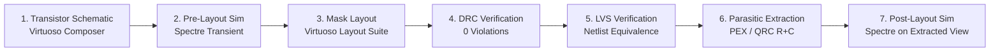

# Full-Custom CMOS Integrated Circuit Design in Cadence Virtuoso


-brightgreen?style=for-the-badge)
-brightgreen?style=for-the-badge)


---

## 1. Project Overview

This repository documents a comprehensive **Full-Custom CMOS Integrated Circuit (VLSI) Design Portfolio** implemented using the **Cadence Virtuoso** Electronic Design Automation (EDA) suite. 

The project spans the full silicon-oriented engineering lifecycle: from transistor-level circuit conception and Boolean logic formulation, to schematic entry, functional testbench simulation, physical mask polygon layout, physical verification (**DRC** and **LVS**), parasitic extraction (**PEX**), and **post-layout transient simulation**.

> *"A circuit is not considered complete when its logic is correct, but when its functionality survives the journey from abstraction to physical geometry."*

---

## 2. Repository Structure

```text
Design ICs/
├── README.md                                    # Master portfolio overview (you are here)
├── Cadence report RA2411004010364.docx          # Source design documentation
├── docs/
│   ├── cadence_virtuoso_workflow.md             # End-to-end full-custom design & verification methodology
│   └── specifications_summary.md                 # Performance matrix & verification status table
│
├── standard_cells/                              # Combinational standard logic cells
│   ├── 01_or_gates/                             # 2, 3, 4, 5-Input CMOS OR Gates
│   │   ├── README.md                            # Theory, equations, truth tables & waveforms
│   │   └── assets/                              # Schematics, symbols, testbenches & waveforms
│   ├── 02_and_gates/                            # 2, 3, 4, 5-Input CMOS AND Gates
│   │   ├── README.md
│   │   └── assets/
│   └── 03_xor_gates/                            # 3-Input CMOS XOR Gate (Odd Parity / CLA Sum)
│       ├── README.md
│       └── assets/
│
└── macro_circuits/                              # Sequential & Arithmetic Custom Macro ICs
    ├── 01_d_latch/                              # Level-sensitive CMOS D-Latch
    │   ├── README.md                            # Transistor design, layout, DRC/LVS, post-sim
    │   └── assets/                              # High-resolution CAD assets
    ├── 02_master_slave_d_flip_flop/             # Positive Edge-Triggered Master-Slave DFF
    │   ├── README.md                            # Race-free sequential storage, setup/hold analysis
    │   └── assets/
    ├── 03_register_4bit/                        # 4-Bit Parallel-In Parallel-Out (PIPO) Register
    │   ├── README.md                            # Multi-bit datapath, bus routing, post-sim
    │   └── assets/
    ├── 04_counter_8bit/                         # 8-Bit Synchronous Binary Counter
    │   ├── README.md                            # Modulo-256 counter, clock distribution, post-sim
    │   └── assets/
    └── 05_cla_adder_4bit/                       # 4-Bit Carry Look-Ahead Adder (CLA)
        ├── README.md                            # Parallel carry generation, high-speed arithmetic
        └── assets/
```

---

## 3. Circuit Blocks & Design Gallery

### 3.1 Full-Custom Macro Circuits

| Macro Block | Schematic View | Physical Mask Layout | Post-Layout Waveforms | Documentation |
| :--- | :---: | :---: | :---: | :---: |
| **D-Latch** | [Schematic](macro_circuits/01_d_latch/assets/d_latch_schematic.png) | [Layout](macro_circuits/01_d_latch/assets/d_latch_layout.png) | [Post-Sim Waveform](macro_circuits/01_d_latch/assets/d_latch_post_sim_waveform.jpeg) | [D-Latch Docs](macro_circuits/01_d_latch/README.md) |
| **Master-Slave D Flip-Flop** | [Schematic](macro_circuits/02_master_slave_d_flip_flop/assets/dff_schematic.png) | [Layout](macro_circuits/02_master_slave_d_flip_flop/assets/dff_layout.png) | [Post-Sim Waveform](macro_circuits/02_master_slave_d_flip_flop/assets/dff_post_sim_waveform.png) | [DFF Docs](macro_circuits/02_master_slave_d_flip_flop/README.md) |
| **4-Bit Parallel Register** | [Schematic](macro_circuits/03_register_4bit/assets/reg4_schematic.png) | [Layout](macro_circuits/03_register_4bit/assets/reg4_layout.png) | [Post-Sim Waveform](macro_circuits/03_register_4bit/assets/reg4_post_sim_waveform.jpeg) | [Register Docs](macro_circuits/03_register_4bit/README.md) |
| **8-Bit Synchronous Counter** | [Schematic](macro_circuits/04_counter_8bit/assets/counter8_schematic.png) | [Layout](macro_circuits/04_counter_8bit/assets/counter8_layout.png) | [Post-Sim Waveform](macro_circuits/04_counter_8bit/assets/counter8_post_sim_waveform.png) | [Counter Docs](macro_circuits/04_counter_8bit/README.md) |
| **4-Bit CLA Adder** | [Schematic](macro_circuits/05_cla_adder_4bit/assets/cla4_schematic.png) | [Layout](macro_circuits/05_cla_adder_4bit/assets/cla4_layout.png) | [Post-Sim Waveform](macro_circuits/05_cla_adder_4bit/assets/cla4_post_sim_waveform.png) | [CLA Docs](macro_circuits/05_cla_adder_4bit/README.md) |

---

### 3.2 Combinational Standard Cell Library

| Cell Family | Variants | Logic Equations | Testbench & Waveforms | Documentation |
| :--- | :---: | :--- | :---: | :---: |
| **OR Gates** | 2, 3, 4, 5-Input | $Y = \sum \text{Inputs}$ | [Waveforms](standard_cells/01_or_gates/assets/or2_pre_sim_waveform.png) | [OR Library Docs](standard_cells/01_or_gates/README.md) |
| **AND Gates** | 2, 3, 4, 5-Input | $Y = \prod \text{Inputs}$ | [Waveforms](standard_cells/02_and_gates/assets/and2_pre_sim_waveform.png) | [AND Library Docs](standard_cells/02_and_gates/README.md) |
| **XOR Gates** | 3-Input | $Y = A \oplus B \oplus C$ | [Waveforms](standard_cells/03_xor_gates/assets/xor3_pre_sim_waveform.png) | [XOR Library Docs](standard_cells/03_xor_gates/README.md) |

---

## 4. Full-Custom Design Flow in Cadence Virtuoso



1. **Schematic Capture:** Designed at the CMOS transistor level ($W/L$ ratios optimized for symmetric $t_{rise}$ / $t_{fall}$ and noise margin).
2. **Pre-Layout Simulation:** Evaluated using Cadence Spectre simulator with ideal wiring to verify digital functionality.
3. **Physical Layout:** Full-custom polygon entry obeying micron/nanometer foundry geometric rules, active diffusion sharing, and power/ground rail metallization.
4. **Design Rule Checking (DRC):** Checked against DRC rule decks; **achieved 0 errors**.
5. **Layout Versus Schematic (LVS):** Extracted layout connectivity compared against golden schematics; **verified 100% matched netlists**.
6. **Parasitic Extraction (PEX):** Extraction of distributed parasitic interconnect resistances ($R$) and capacitances ($C$).
7. **Post-Layout Simulation:** Executed on the extracted view to validate timing preservation, clock skew immunity, and slew performance.

For comprehensive details on each stage, refer to the [Cadence Virtuoso Design Methodology Guide](docs/cadence_virtuoso_workflow.md).

---

## 5. Physical Verification Results

All five custom macro blocks were subjected to rigorous physical verification:

```text
================================================================================
 PHYSICAL VERIFICATION STATUS SUMMARY
================================================================================
 Circuit Block             | DRC Status | LVS Status | Post-Sim Status
---------------------------+------------+------------+-----------------
 D-Latch                   | 0 Errors   | Matched    | Validated
 Master-Slave D Flip-Flop  | 0 Errors   | Matched    | Validated
 4-Bit Parallel Register   | 0 Errors   | Matched    | Validated
 8-Bit Synchronous Counter | 0 Errors   | Matched    | Validated
 4-Bit CLA Adder           | 0 Errors   | Matched    | Validated
================================================================================
```

---

## 6. How to Reproduce / View in Cadence Virtuoso

1. **Launch Environment:**
   ```bash
   source <cadence_installation_path>/cshrc
   virtuoso &
   ```
2. **Library Manager:**
   - Open Library Manager (`Tools -> Library Manager`).
   - Import or reference the cell views (`schematic`, `symbol`, `layout`, `extracted`).
3. **Simulation:**
   - Launch ADE L or ADE Explorer (`Launch -> ADE L`).
   - Load the respective testbench state.
   - For pre-layout: choose design view `schematic`.
   - For post-layout: choose design view `av_extracted` or `calibre`.
   - Execute transient analysis and plot outputs.

---

## 7. Author & Acknowledgements

* **Design Author:** RA2411004010364
* **CAD Tools:** Cadence Virtuoso IC Design Suite, Spectre Circuit Simulator, Virtuoso Layout Suite, Physical Verification DRC/LVS.
