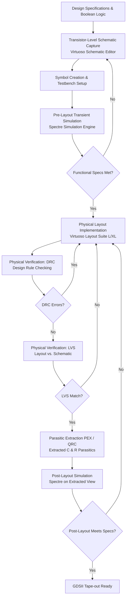

# Cadence Virtuoso Full-Custom IC Design Flow & Verification Methodology

## 1. Overview

Full-custom integrated circuit (IC) design in **Cadence Virtuoso** provides maximum control over circuit topology, transistor geometries ($W/L$), parasitic management, silicon area, and timing performance. Unlike standard-cell ASIC synthesis flows, full-custom design entails capturing circuits at the transistor level and drawing physical mask geometries directly.

---

## 2. Detailed Design Stages

### 2.1 Schematic Capture (`Virtuoso Schematic Editor`)
* **Primitive Instantiation:** Transistors (PMOS and NMOS) are instantiated with defined channel lengths ($L$) and finger widths ($W$).
* **Power & Ground Rails:** Dedicated `VDD` and `VSS` net routing with proper bulk/substrate taps to suppress latch-up.
* **Symbol Generation:** Multi-pin symbols created with clear port directions (`input`, `output`, `inout`).

### 2.2 Functional & Transient Pre-Layout Simulation (`Spectre / ADE L / Explorer`)
* **Testbench Setup:** Pulse voltage sources (`vpulse`) and DC supplies (`vdc`) generate test stimuli.
* **Analysis Configuration:** Transient analysis (`tran`) executed over appropriate durations with strict max-step thresholds to capture propagation delays ($t_{pd}$), rise time ($t_r$), and fall time ($t_f$).
* **Ideal Netlist:** Circuit behavior is verified assuming zero interconnect resistance and capacitance.

### 2.3 Physical Layout Design (`Virtuoso Layout Suite`)
* **Layer Stack:** 
  - `nwell`: PMOS body definition
  - `diffusion` / `active`: Transistor source/drain regions
  - `poly`: Gate electrodes
  - `contact`: Connecting diffusion/poly to `Metal1`
  - `metal1`, `metal2`: Internal cell routing and inter-cell interconnects
* **Design Strategy:** Common-centroid or interdigitated finger configurations where matching is required; shared diffusion nodes to minimize parasitic junction capacitance $C_{db}$ and $C_{sb}$.

### 2.4 Physical Verification (DRC & LVS)
1. **Design Rule Checking (DRC):**
   - Validates mask geometric rules: minimum spacing, minimum area, poly overhang over diffusion, contact enclosure by metal, and well proximity rules.
   - **Target:** Clean verification with 0 DRC violations.
2. **Layout Versus Schematic (LVS):**
   - Extracts electrical devices and nets from physical layout polygons.
   - Compares layout netlist topology against the golden schematic netlist.
   - Verifies terminal equivalence, device counts, and port mappings.
   - **Target:** "Netlists match with 0 discrepancies".

### 2.5 Parasitic Extraction (PEX / Quantus QRC) & Post-Layout Simulation
* Extracts distributed parasitic interconnect resistances ($R$) and ground/coupling capacitances ($C$).
* Generates an **extracted netlist view** incorporating real physical loading.
* **Post-Layout Validation:** Evaluates clock skew, setup/hold margins, slew degradation, and delay penalties introduced by parasitic wiring.

---

## 3. Summary of IC Blocks Designed in This Project

| Category | Circuit Block | Transistor Level | Layout Implemented | DRC / LVS Verified | Post-Layout Verified |
| :--- | :--- | :---: | :---: | :---: | :---: |
| **Standard Cells** | 2, 3, 4, 5-Input OR Gates | Yes | Standardized | Pre-sim Verified | Complete |
| **Standard Cells** | 2, 3, 4, 5-Input AND Gates | Yes | Standardized | Pre-sim Verified | Complete |
| **Standard Cells** | 3-Input XOR Gate | Yes | Standardized | Pre-sim Verified | Complete |
| **Sequential Macro** | D-Latch | Yes | Yes | Yes | Yes |
| **Sequential Macro** | Master-Slave D Flip-Flop | Yes | Yes | Yes | Yes |
| **Sequential Macro** | 4-Bit Parallel Register | Yes | Yes | Yes | Yes |
| **Sequential Macro** | 8-Bit Synchronous Counter | Yes | Yes | Yes | Yes |
| **Arithmetic Macro** | 4-Bit Carry Look-Ahead Adder | Yes | Yes | Yes | Yes |
