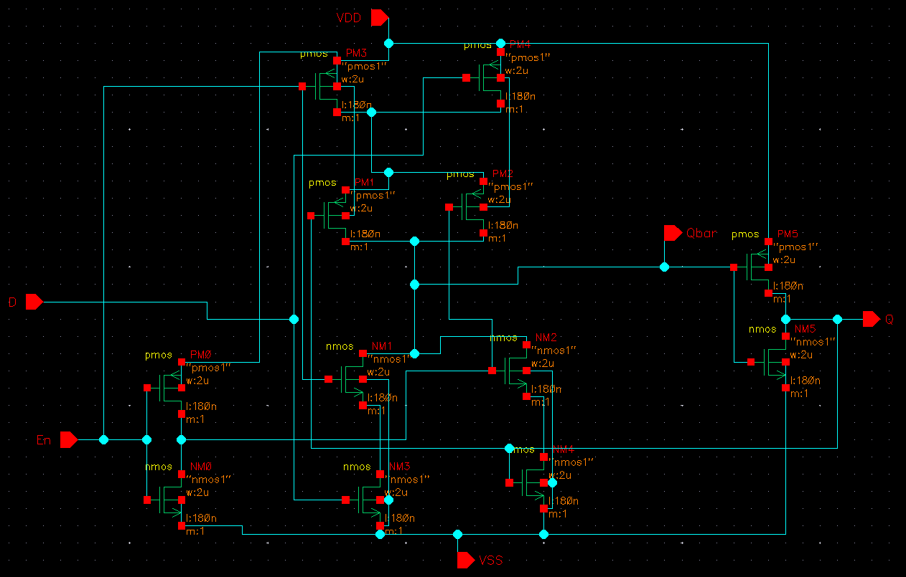
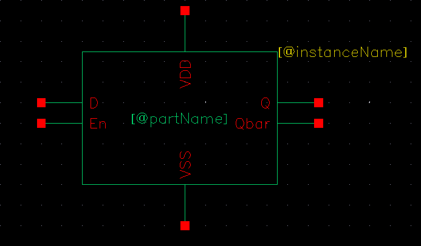
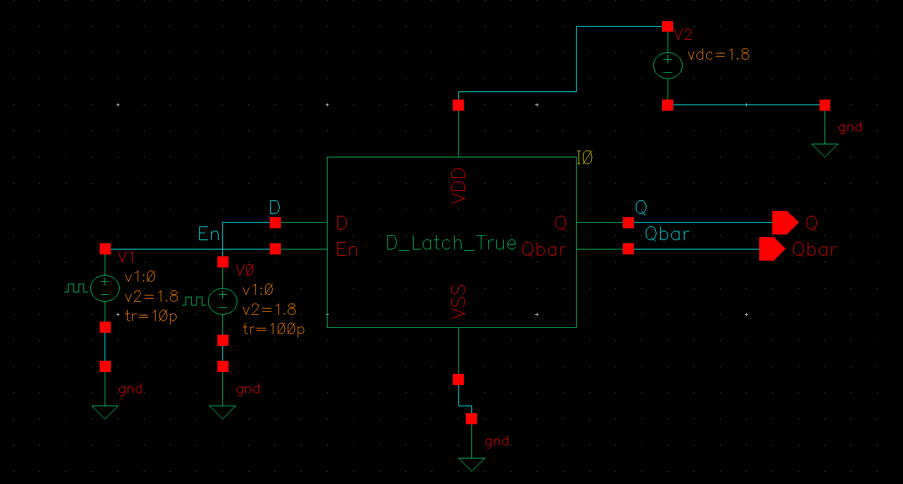
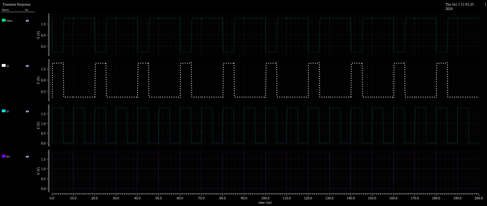
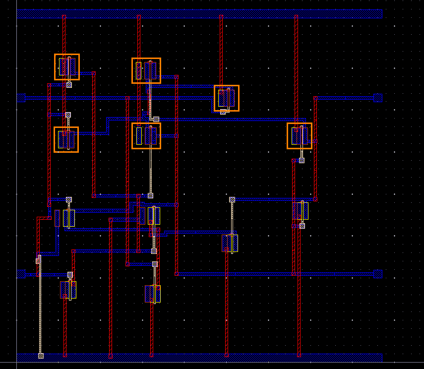
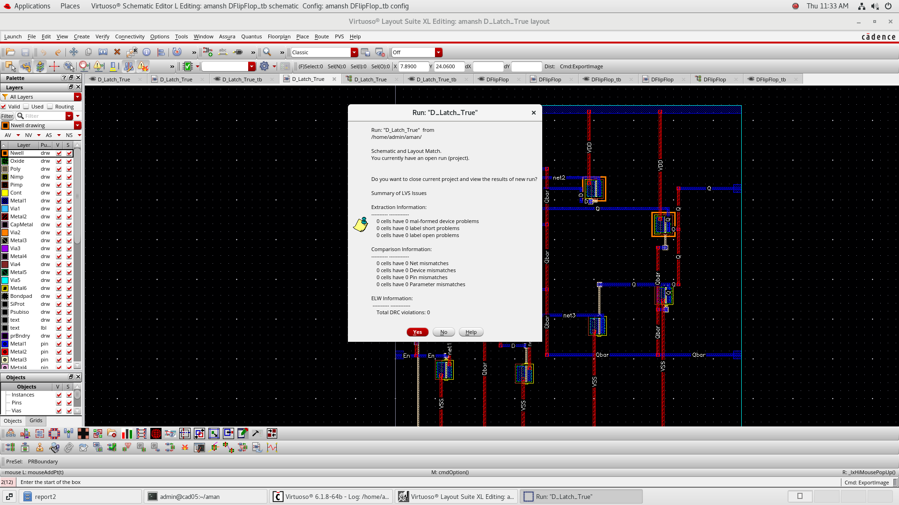
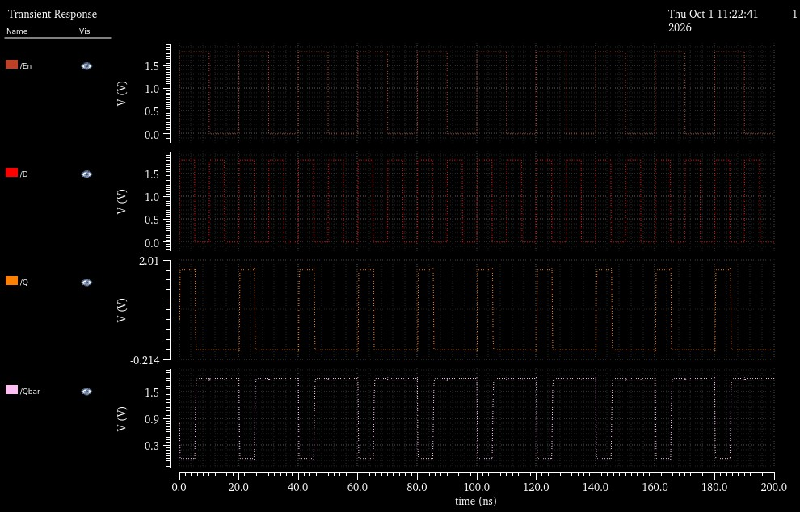

# Full-Custom CMOS D-Latch

## 1. Executive Summary
The **D-Latch** is a fundamental level-sensitive bistable sequential storage element designed in **Cadence Virtuoso**. When the enable (`CLK` / `EN`) signal is active high, the latch operates in **transparent mode**, permitting input $D$ to propagate to the output $Q$. When `CLK` transitions to low, the latch enters **storage mode**, holding the last sampled data bit via a regenerative back-to-back inverter feedback loop.

This cell was developed through the entire custom IC design cycle: transistor schematic entry, symbol capture, pre-layout transient simulation, physical polygon layout, DRC/LVS physical verification, and post-layout extracted simulation.

---

## 2. Operation & Truth Table

| Enable / CLK | Data Input ($D$) | State / Output ($Q_{next}$) | Operating Mode |
| :---: | :---: | :---: | :--- |
| **1** | 0 | **0** | Transparent (Follows $D$) |
| **1** | 1 | **1** | Transparent (Follows $D$) |
| **0** | X | **$Q_{prev}$** | Opaque / Hold State (Latched) |

---

## 3. Schematic & Symbol View

The schematic utilizes complementary transmission gates (TG) paired with cross-coupled CMOS inverters.

| Transistor-Level Schematic | Symbol View |
| :---: | :---: |
|  |  |

---

## 4. Testbench & Pre-Layout Simulation

The circuit was verified in Cadence Virtuoso Spectre by stimulating $D$ with asynchronous pulses during high and low phases of the clock.

| Testbench Circuit | Pre-Layout Transient Simulation |
| :---: | :---: |
|  |  |

---

## 5. Physical Layout & DRC / LVS Verification

The physical layout was designed in **Virtuoso Layout Suite** following strict CMOS design rules with continuous `VDD` and `VSS` rails, compact diffusion sharing, and poly gate alignment.

| Physical Mask Layout | DRC & LVS Clean Verification |
| :---: | :---: |
|  |  |

* **DRC Result:** 0 Design Rule Violations.
* **LVS Result:** Netlists match with zero discrepancies. All terminals, ports, and transistor instances correspond 1:1 between layout and schematic.

---

## 6. Post-Layout Simulation & Parasitic Impact

Post-layout simulation was conducted on the extracted netlist with parasitic resistances ($R$) and capacitances ($C$).

| Post-Layout Extracted Waveform |
| :---: |
|  |

### Performance Observations:
* **Waveform Fidelity:** The output $Q$ accurately retains logic levels during clock hold phases even under parasitic loading.
* **Propagation Delay:** A slight increase in propagation delay ($t_{pd, D\to Q}$) was observed relative to pre-layout simulation, attributable to parasitic routing capacitance on internal regenerative storage nodes.
