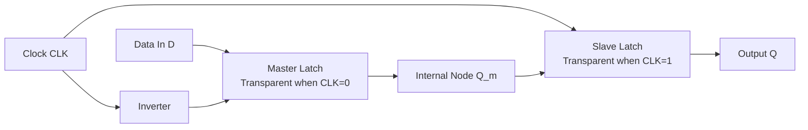
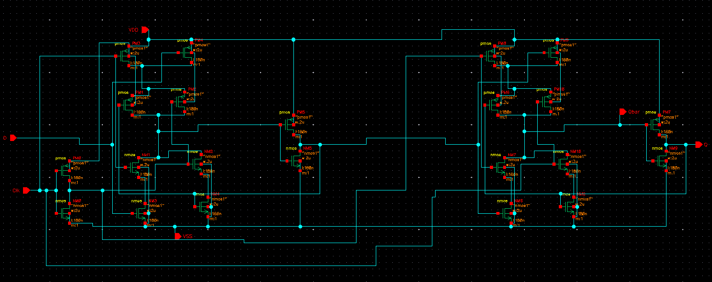
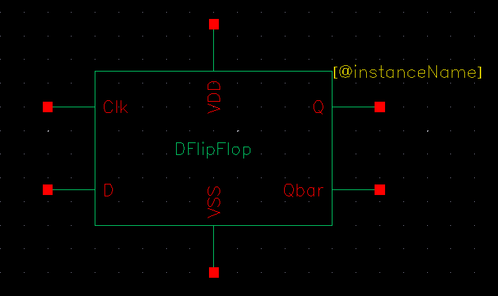
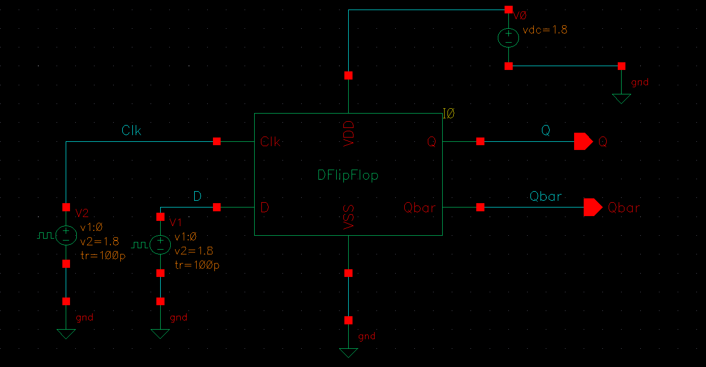
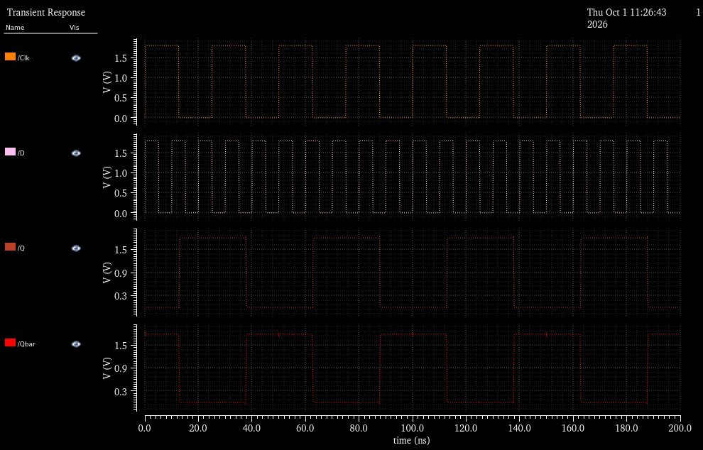
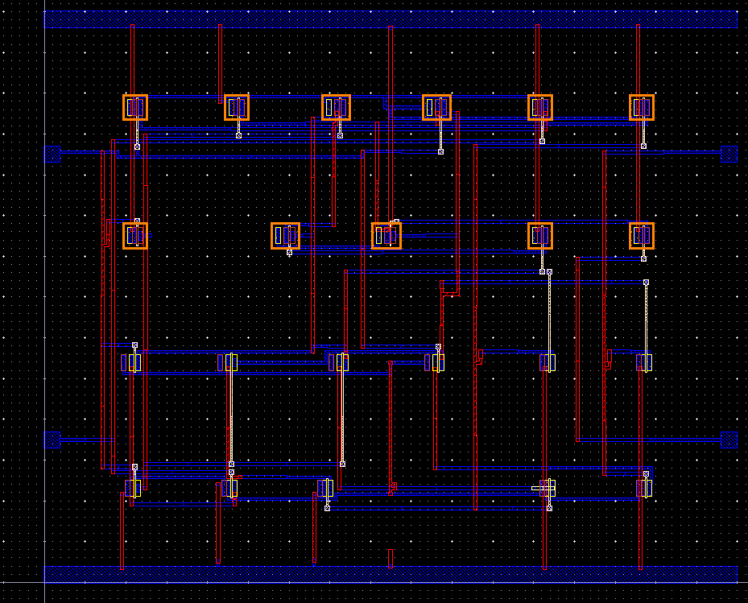
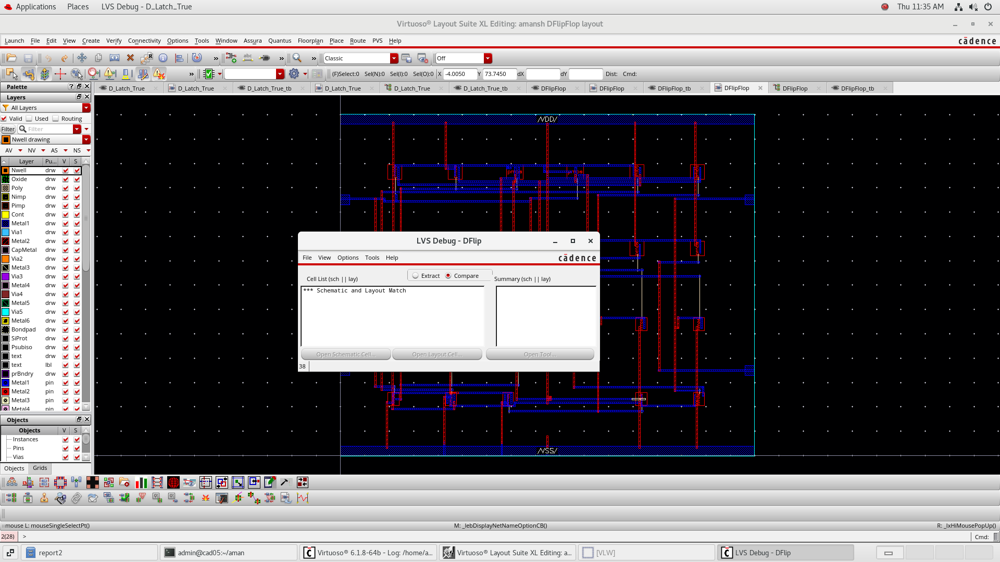
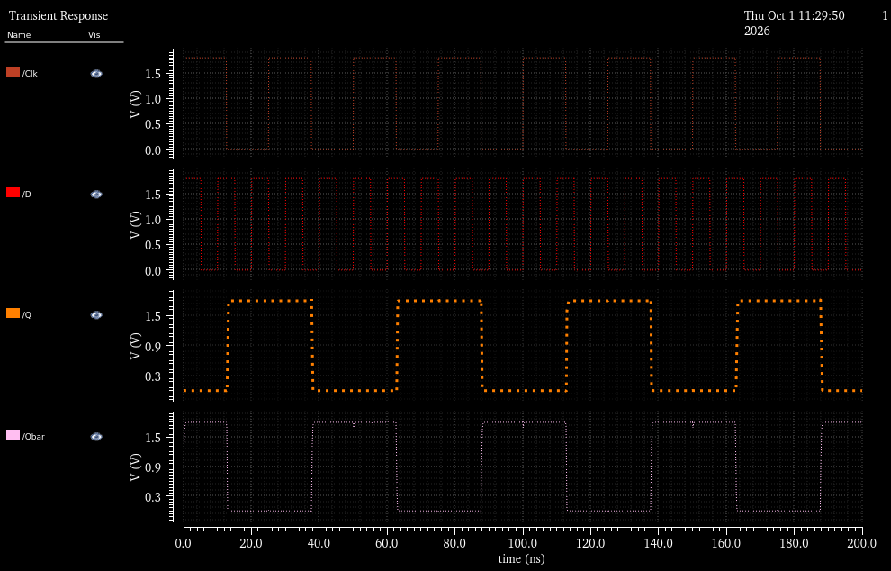

# Master-Slave D Flip-Flop (Edge-Triggered)

## 1. Executive Summary
The **Master-Slave D Flip-Flop (DFF)** is a sequential storage cell designed in **Cadence Virtuoso** to provide positive edge-triggered data sampling. By cascading two opposite-phase D-Latches (a negative-transparent **Master Latch** followed by a positive-transparent **Slave Latch**), race-around conditions and transparency hazards are eliminated.

This cell forms the atomic synchronous memory unit for the higher-level sequential macros: the **4-Bit Parallel Register** and the **8-Bit Synchronous Counter**.

---

## 2. Master-Slave Architecture & Timing

* **When `CLK = 0`:** Master latch is transparent and samples $D$; Slave latch is opaque and holds the previous output $Q$.
* **When `CLK` transitions $0 \to 1$ (Rising Edge):** Master latch latches $D$ and becomes opaque; Slave latch turns transparent and drives the latched data to output $Q$.
* **When `CLK = 1`:** Any further transitions on $D$ are blocked by the opaque Master latch, ensuring edge-triggered behavior.

---

## 3. Schematic & Symbol View

| Transistor-Level Schematic | Symbol View |
| :---: | :---: |
|  |  |

---

## 4. Testbench & Pre-Layout Simulation

The flip-flop was validated in Spectre by driving clock and data signals with varying edge alignments to assess setup ($t_{su}$) and hold ($t_h$) timing.

| Testbench Circuit | Pre-Layout Transient Simulation Waveform |
| :---: | :---: |
|  |  |

---

## 5. Physical Layout & DRC / LVS Verification

The physical layout was designed in Virtuoso Layout Suite with careful matching of clock inverter routing paths to minimize internal clock skew between Master and Slave transmission gates.

| Physical Mask Layout | DRC & LVS Clean Verification |
| :---: | :---: |
|  |  |

* **DRC Status:** Clean (0 violations).
* **LVS Status:** Complete match across all extracted MOS instances, ports, and interconnections.

---

## 6. Post-Layout Simulation & Waveform Analysis

| Post-Layout Extracted Waveform |
| :---: |
|  |

### Key Observations:
* **Edge-Triggered Integrity:** Output $Q$ updates strictly at rising clock edges without glitching during transparent periods.
* **Clock-to-Q Delay ($t_{C-Q}$):** Post-layout parasitics introduce a modest increase in delay, well within standard CMOS digital operating margins.
