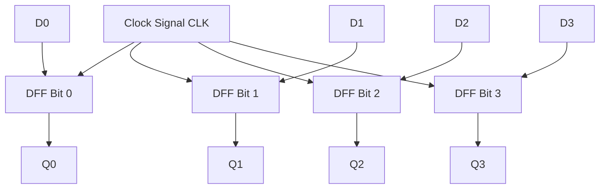
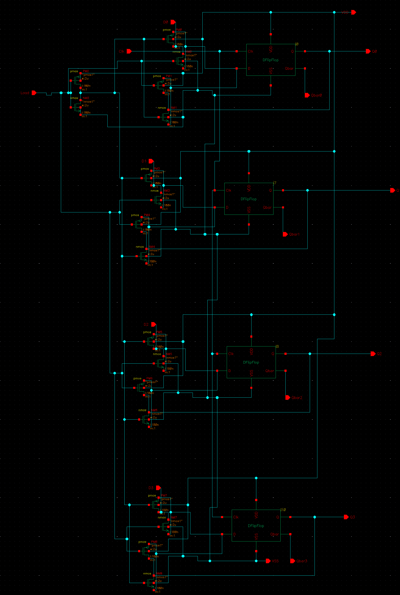
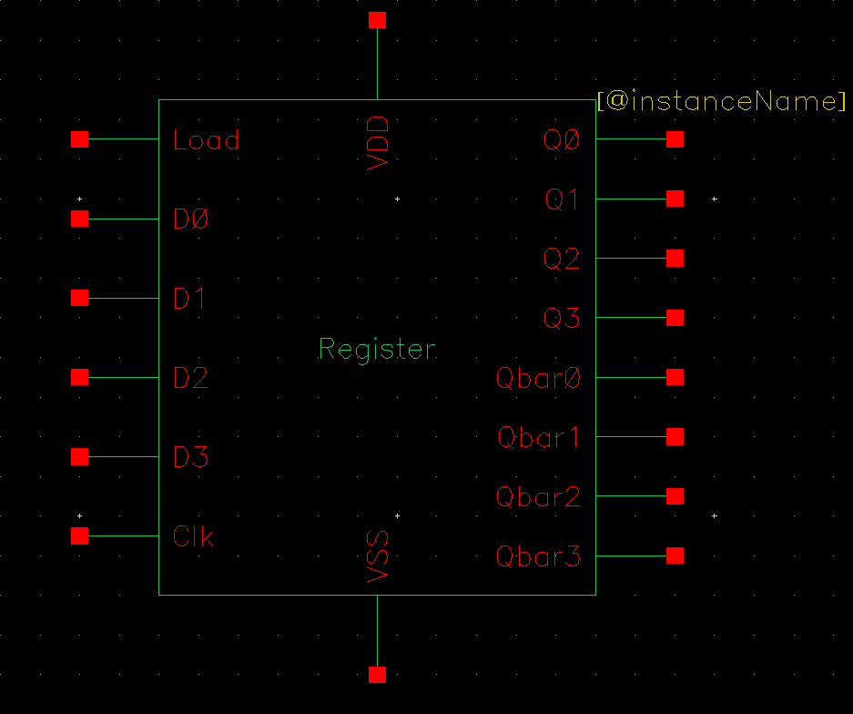
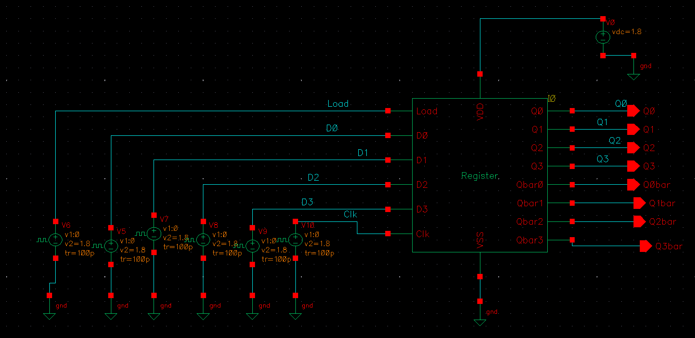
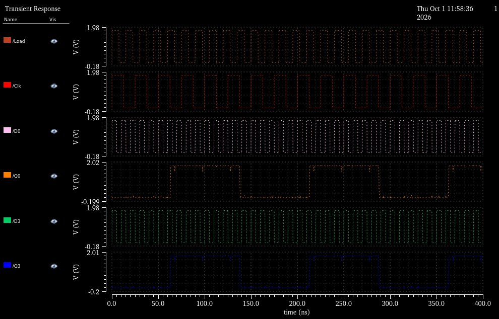
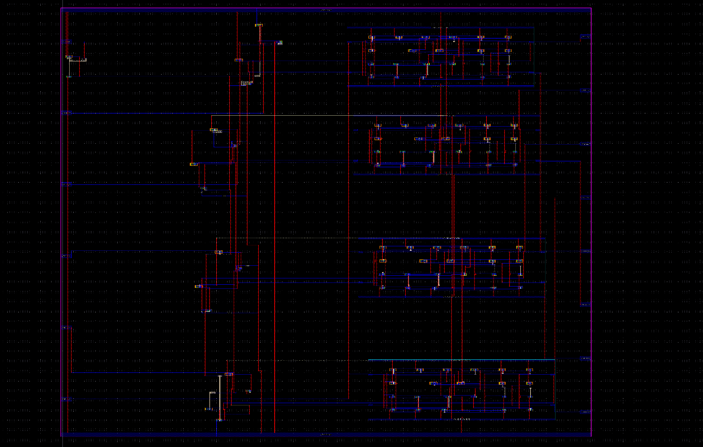
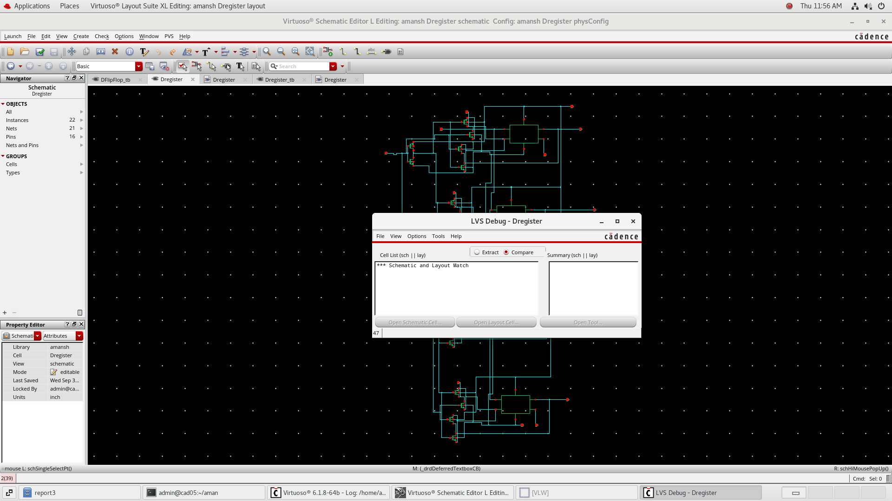

# 4-Bit Parallel-In Parallel-Out (PIPO) Register

## 1. Executive Summary
The **4-Bit Register** is a multi-bit synchronous data storage macro designed in **Cadence Virtuoso**. It incorporates four instantiations of the edge-triggered **Master-Slave D Flip-Flop**, sharing a common clock network and power routing. On each positive clock transition, four parallel input bits $D[3:0]$ are latched simultaneously and presented on output bus $Q[3:0]$.

This circuit represents the transition from atomic cell design to multi-bit datapath register design in custom VLSI.

---

## 2. Bus Architecture & Pin Specifications

| Signal Name | Width | Direction | Function |
| :--- | :---: | :---: | :--- |
| `D[3:0]` | 4 bits | Input | Parallel data input bus |
| `CLK` | 1 bit | Input | Synchronous sampling clock |
| `Q[3:0]` | 4 bits | Output | Latched output data bus |
| `VDD` / `VSS` | 1 bit | Power | Core supply voltage & ground |

---

## 3. Schematic & Symbol View

| Hierarchical Schematic | Symbol View |
| :---: | :---: |
|  |  |

---

## 4. Testbench & Pre-Layout Simulation

The 4-bit register testbench applies synchronized data patterns across $D_0, D_1, D_2, D_3$ alongside a periodic clock signal to verify multi-bit parallel retention and setup/hold behavior.

| Testbench Circuit | Pre-Layout Transient Simulation Waveforms |
| :---: | :---: |
|  |  |

---

## 5. Physical Layout & DRC / LVS Verification

The physical layout integrates the four DFF bit-slices in an abutted linear floorplan, sharing continuous `VDD` and `VSS` horizontal power rails to maximize silicon area efficiency.

| Full-Custom Mask Layout | DRC & LVS Clean Verification |
| :---: | :---: |
|  |  |

* **DRC Status:** 0 Design Rule Violations.
* **LVS Status:** Complete correspondence between hierarchical schematic and layout netlist.

---

## 6. Post-Layout Simulation

| Post-Layout Extracted Waveform |
| :---: |
|  |

### Key Observations:
* **Clock Skew Control:** Balanced clock tree routing ensures minimal clock skew across all four bit positions ($Q_0$ through $Q_3$).
* **Bus Consistency:** Multi-bit outputs switch synchronously with consistent rise and fall slew rates under parasitic loading.
