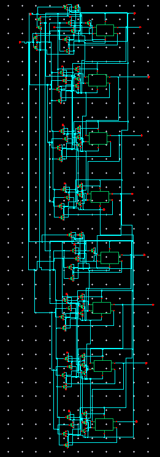
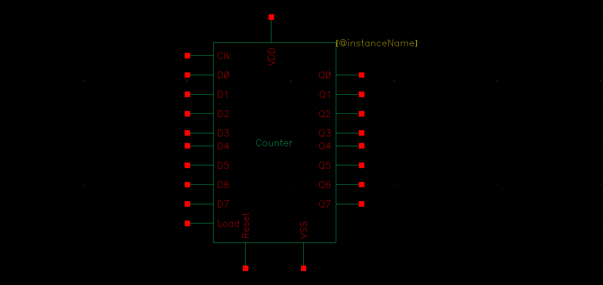
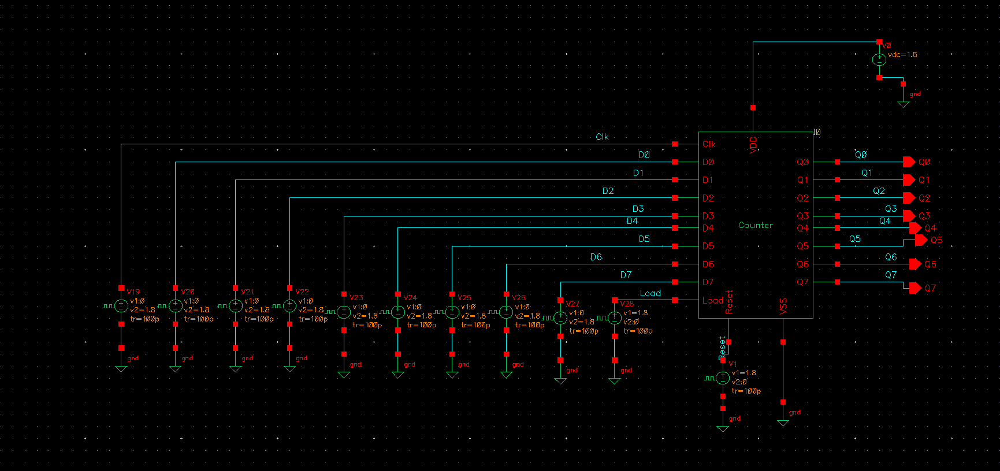
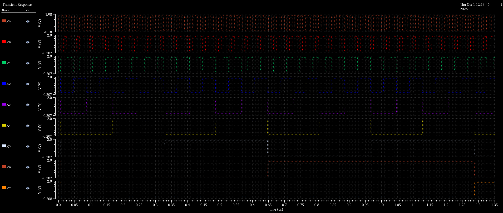
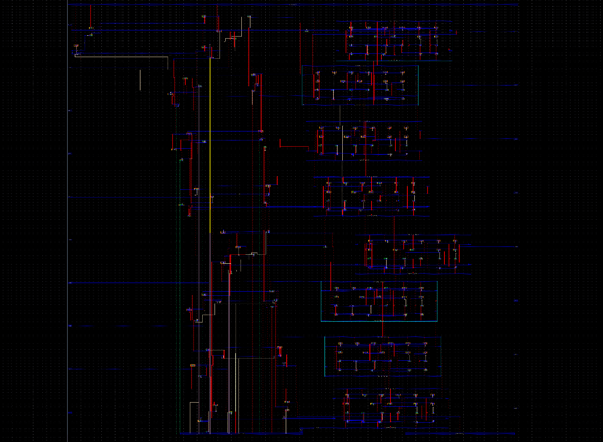
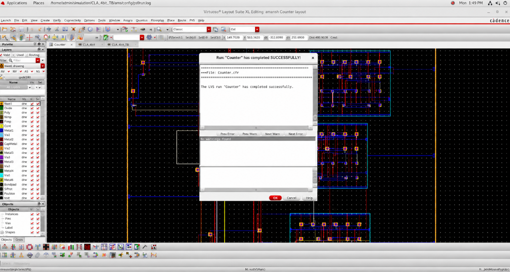
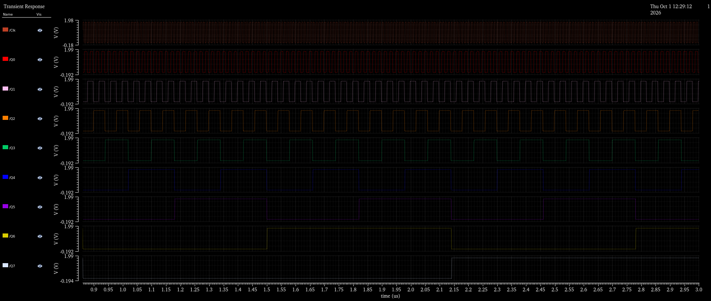

# 8-Bit Synchronous Binary Counter

## 1. Executive Summary
The **8-Bit Counter** is an advanced sequential macro block designed in **Cadence Virtuoso**. It counts from $0$ to $255$ ($00_{16}$ to $\text{FF}_{16}$) on successive clock pulses across eight output bits $Q[7:0]$. The design incorporates cascaded flip-flop stages with toggle steering logic to realize synchronous binary counting.

This macro demonstrates multi-stage sequential scaling, clock distribution tree management, and large-area layout physical verification in full-custom VLSI.

---

## 2. Operation & State Space

* **Counting Modulo:** Modulo-256 ($2^8 = 256$ distinct states).
* **Clocking:** Positive-edge synchronous updating across all output stages $Q_0, Q_1, \dots, Q_7$.
* **Frequency Division:** Each successive output bit toggles at half the frequency of the preceding bit:
  - $f(Q_0) = \frac{1}{2} f_{CLK}$
  - $f(Q_1) = \frac{1}{4} f_{CLK}$
  - $\dots$
  - $f(Q_7) = \frac{1}{256} f_{CLK}$

---

## 3. Schematic & Symbol View

| Transistor / Cell-Level Schematic | Symbol View |
| :---: | :---: |
|  |  |

---

## 4. Testbench & Pre-Layout Simulation

The testbench supplies clock pulses and reset conditions to evaluate binary state transitions across the 8-bit bus.

| Testbench Circuit | Pre-Layout Transient Simulation Waveforms |
| :---: | :---: |
|  |  |

---

## 5. Physical Layout & DRC / LVS Verification

The physical layout organizes the eight bit-stages into an integrated floorplan with dedicated power routing, well taps, and uniform clock distribution rails to suppress clock skew.

| Full-Custom Mask Layout | DRC & LVS Clean Verification |
| :---: | :---: |
|  |  |

* **DRC Report:** 0 Geometric Rule Violations.
* **LVS Report:** Complete topology and device equivalence between physical layout and schematic netlist.

---

## 6. Post-Layout Simulation & Waveform Verification

Post-layout simulation was conducted on the extracted RC parasitic view using Spectre to verify switching integrity across all eight output stages.

| Post-Layout Extracted Waveform |
| :---: |
|  |

### Key Observations:
* **Ripple-Free Transitions:** Coordinated switching activity is visible across all 8 output nodes ($Q_0$ through $Q_7$), matching the expected binary frequency division.
* **Parasitic Tolerance:** The circuit maintains noise margins and clear digital switching levels across all states under full extracted parasitics.
