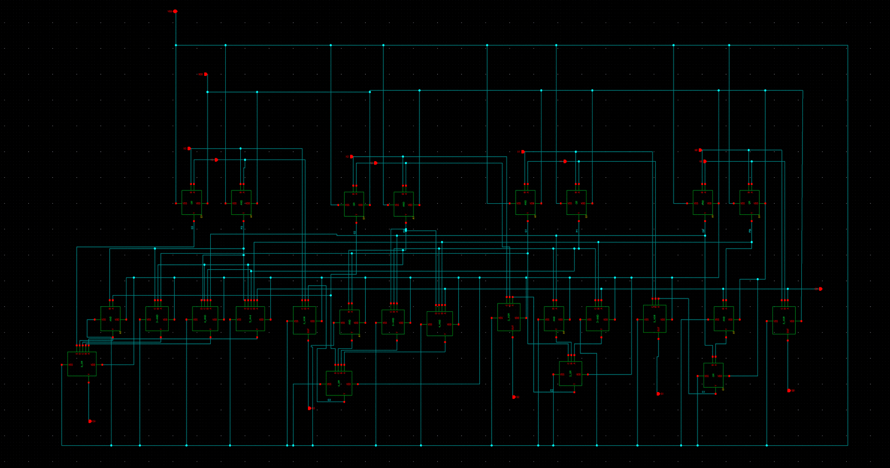
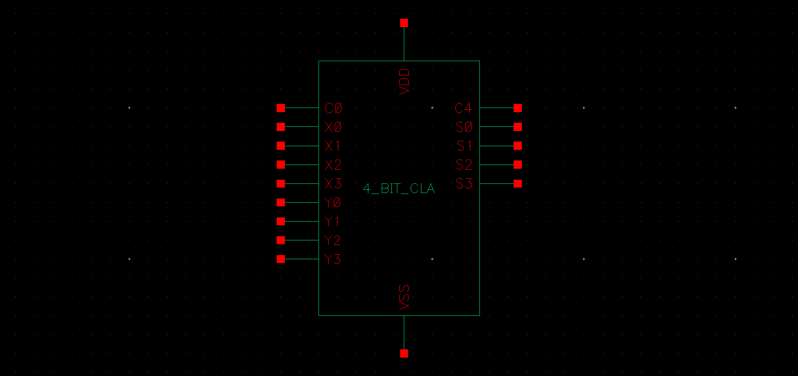
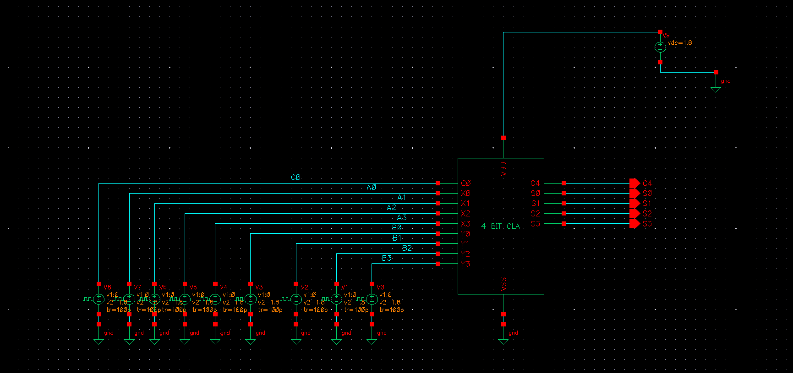
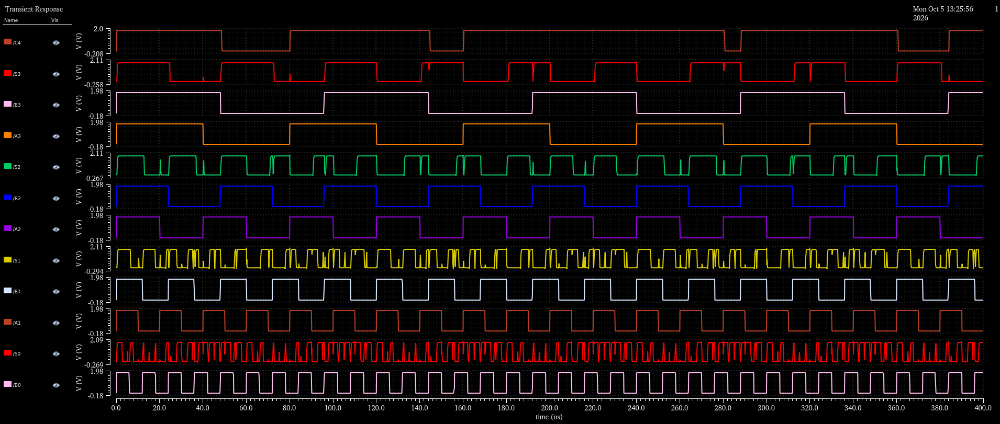
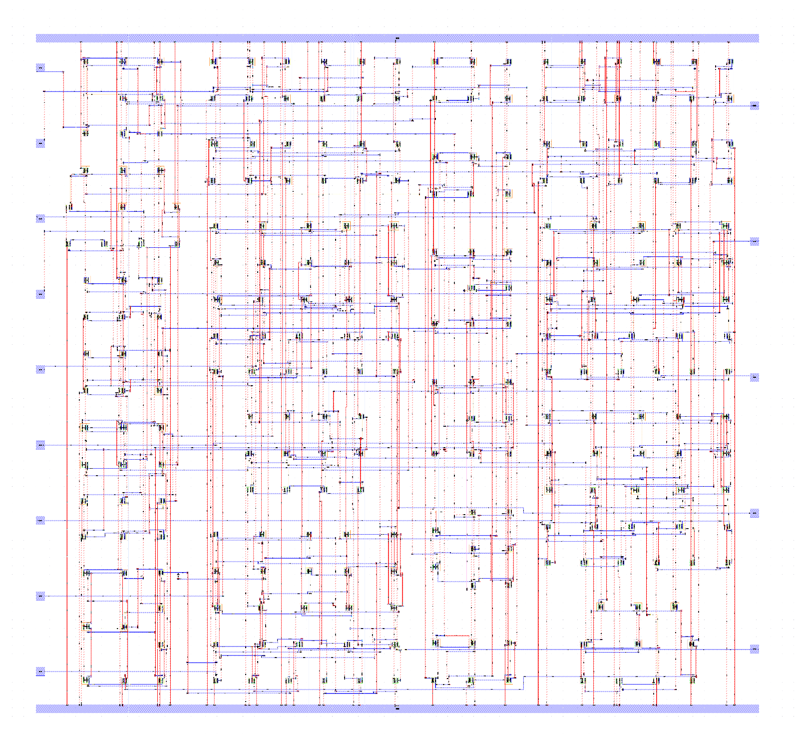
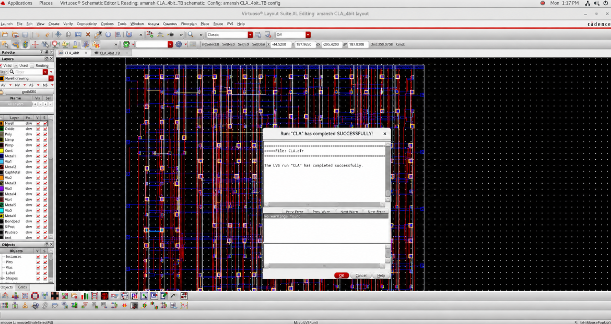
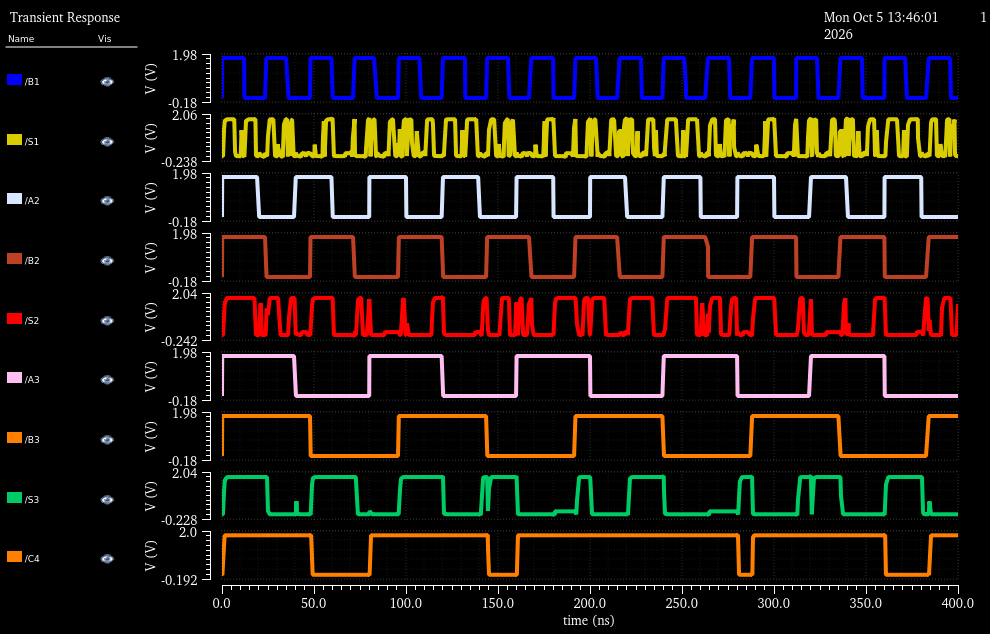

# 4-Bit Carry Look-Ahead Adder (CLA)

## 1. Executive Summary
The **4-Bit Carry Look-Ahead Adder (CLA)** is a high-speed arithmetic macro designed in **Cadence Virtuoso**. Conventional Ripple Carry Adders (RCA) suffer from long propagation delays because the carry signal must ripple linearly through each full-adder stage ($O(n)$ delay). The CLA solves this bottleneck by calculating all carry signals ($C_1, C_2, C_3, C_4$) in parallel ($O(1)$ delay logic) using **Generate ($G_i$)** and **Propagate ($P_i$)** functions.

This macro integrates multiple custom standard cells (2-, 3-, 4-, and 5-input AND/OR gates and 3-input XOR gates) into a hierarchical VLSI architecture.

---

## 2. Mathematical Theory & Carry Logic

For two 4-bit binary operands $A = A_3 A_2 A_1 A_0$ and $B = B_3 B_2 B_1 B_0$ with input carry $C_0$:

### Generate and Propagate Terms:
$$G_i = A_i \cdot B_i \quad \text{(Generate)}$$
$$P_i = A_i \oplus B_i \quad \text{(Propagate)}$$

### Parallel Carry Equations:
* **$C_1$ (Stage 1):**
  $$C_1 = G_0 + P_0 C_0$$
* **$C_2$ (Stage 2):**
  $$C_2 = G_1 + P_1 G_0 + P_1 P_0 C_0$$
* **$C_3$ (Stage 3):**
  $$C_3 = G_2 + P_2 G_1 + P_2 P_1 G_0 + P_2 P_1 P_0 C_0$$
* **$C_4$ (Carry-Out $C_{out}$):**
  $$C_4 = G_3 + P_3 G_2 + P_3 P_2 G_1 + P_3 P_2 P_1 G_0 + P_3 P_2 P_1 P_0 C_0$$

### Sum Output Equations:
$$S_i = P_i \oplus C_i = A_i \oplus B_i \oplus C_i$$

---

## 3. Schematic & Symbol View

| Hierarchical Schematic | Symbol View |
| :---: | :---: |
|  |  |

---

## 4. Testbench & Pre-Layout Simulation

The testbench supplies varying binary vectors to $A[3:0]$, $B[3:0]$, and $C_{in}$ to exercise maximum carry propagation paths.

| Testbench Circuit | Pre-Layout Transient Simulation Waveforms |
| :---: | :---: |
|  |  |

---

## 5. Physical Layout & DRC / LVS Verification

The physical layout integrates the standard gate cells (AND, OR, XOR) with optimized metal routing to minimize interconnect delays on critical carry-propagation paths.

| Full-Custom Mask Layout | DRC & LVS Clean Verification |
| :---: | :---: |
|  |  |

* **DRC Status:** Clean (0 Design Rule Violations).
* **LVS Status:** Schematic and Layout netlists match with zero discrepancies.

---

## 6. Post-Layout Simulation & Waveform Verification

| Post-Layout Extracted Waveform |
| :---: |
|  |

### Key Observations:
* **High-Speed Addition:** The carry-out $C_4$ and sum bits $S[3:0]$ evaluate concurrently with minimal latency divergence, verifying that ripple carry bottlenecks have been eliminated.
* **Layout-Aware Integrity:** Output signal levels demonstrate sharp rise/fall edges and strong driving capability despite parasitics introduced by multi-gate interconnect wiring.
