# CMOS OR Gate Library (2-Input, 3-Input, 4-Input, 5-Input)

## 1. Overview
This module implements a standard-cell library of multi-input CMOS OR gates (2-input, 3-input, 4-input, and 5-input) designed in **Cadence Virtuoso**. In static CMOS logic, an OR function is realized as a **NOR stage** (parallel NMOS pull-down network, series PMOS pull-up network) followed by a **CMOS Inverter** buffer stage to restore drive strength and polarity.

These gates serve as core combinational building blocks for the arithmetic logic inside the **4-Bit Carry Look-Ahead Adder (CLA)**, specifically in computing carry equations ($C_1, C_2, C_3, C_4$).

---

## 2. Gate Topologies & Mathematical Formulation

| Gate | Boolean Equation | Pull-Down NMOS Network | Pull-Up PMOS Network | Output Buffer |
| :--- | :--- | :--- | :--- | :--- |
| **2-Input OR** | $Y = A + B$ | 2 NMOS in parallel | 2 PMOS in series | CMOS Inverter |
| **3-Input OR** | $Y = A + B + C$ | 3 NMOS in parallel | 3 PMOS in series | CMOS Inverter |
| **4-Input OR** | $Y = A + B + C + D$ | 4 NMOS in parallel | 4 PMOS in series | CMOS Inverter |
| **5-Input OR** | $Y = A + B + C + D + E$ | 5 NMOS in parallel | 5 PMOS in series | CMOS Inverter |

---

## 3. Circuit Schematics & Symbols

### 2-Input OR Gate
| Transistor Schematic | Symbol View |
| :---: | :---: |
| 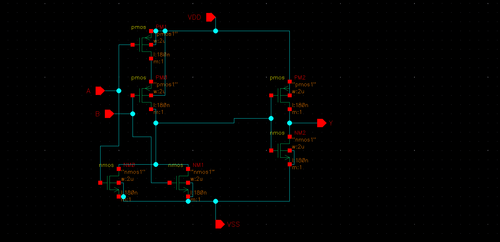 | 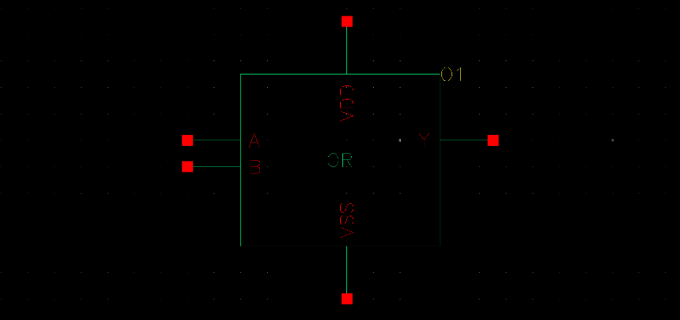 |

### 3-Input OR Gate
| Transistor Schematic | Symbol View |
| :---: | :---: |
| 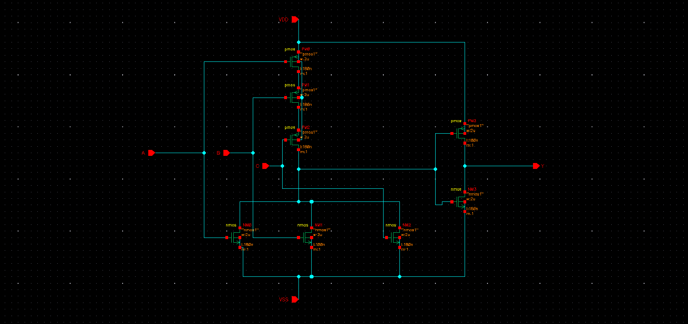 | 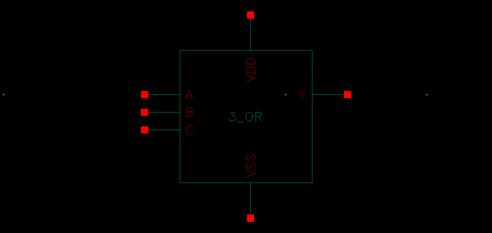 |

### 4-Input OR Gate
| Transistor Schematic | Symbol View |
| :---: | :---: |
| 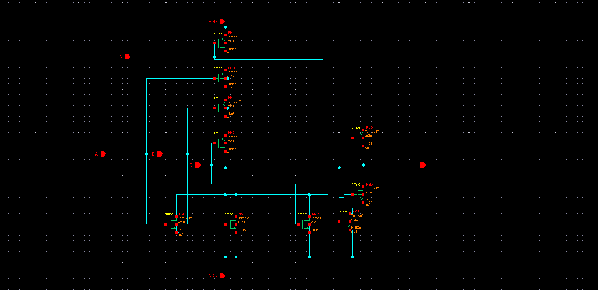 | 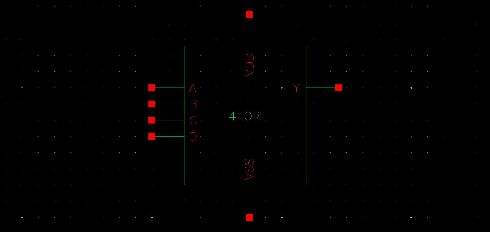 |

### 5-Input OR Gate
| Transistor Schematic | Symbol View |
| :---: | :---: |
| 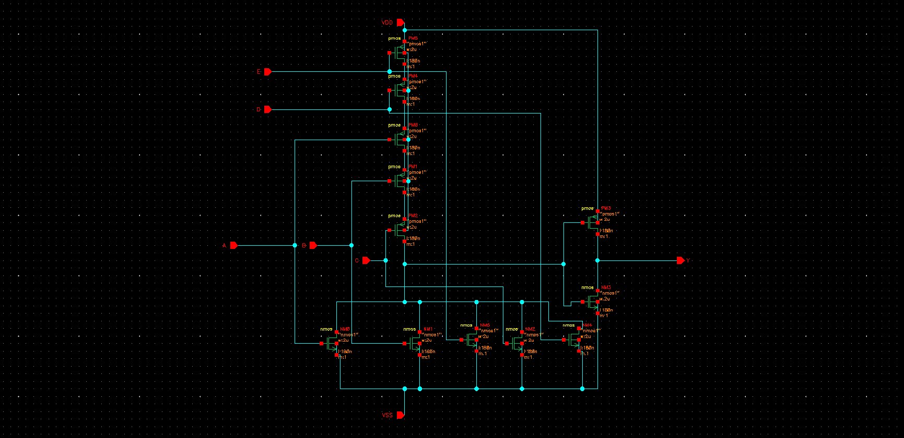 | 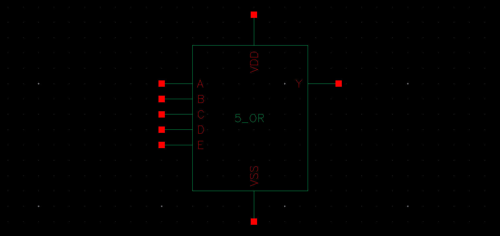 |

---

## 4. Testbenches & Simulation Waveforms

Each cell was evaluated using transient analysis (`tran`) in the Spectre simulation engine with pulsed inputs (`vpulse`) spanning all input permutations.

### 2-Input OR Gate Simulation
| Testbench Setup | Pre-Layout Transient Waveforms |
| :---: | :---: |
| 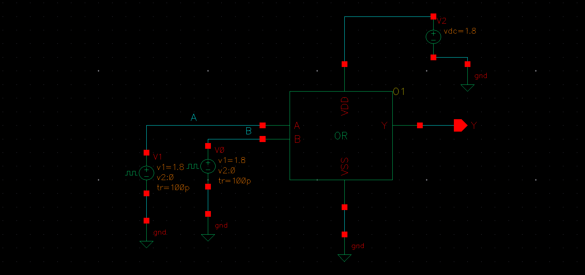 | 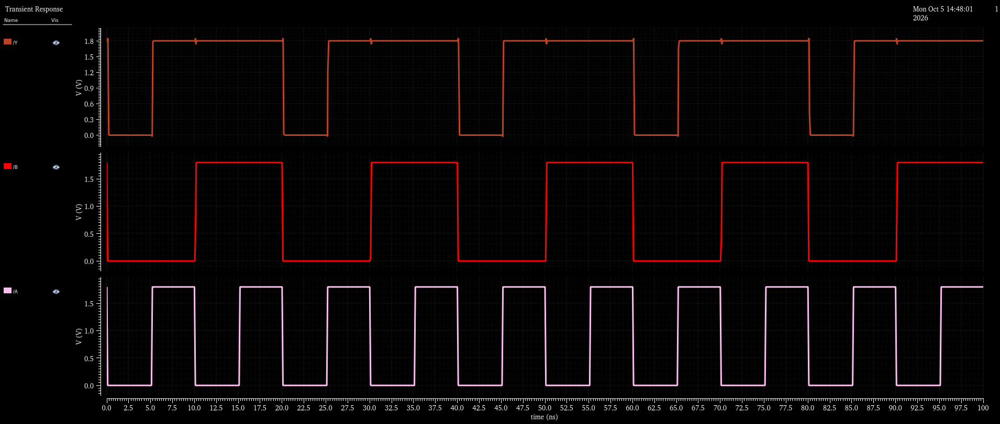 |

### 3-Input OR Gate Simulation
| Testbench Setup | Pre-Layout Transient Waveforms |
| :---: | :---: |
| 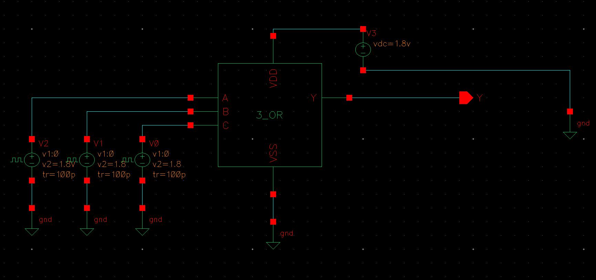 | 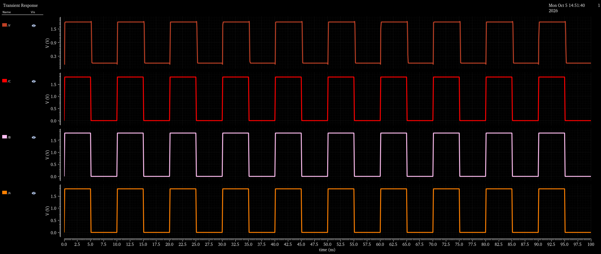 |

### 4-Input OR Gate Simulation
| Testbench Setup | Pre-Layout Transient Waveforms |
| :---: | :---: |
| 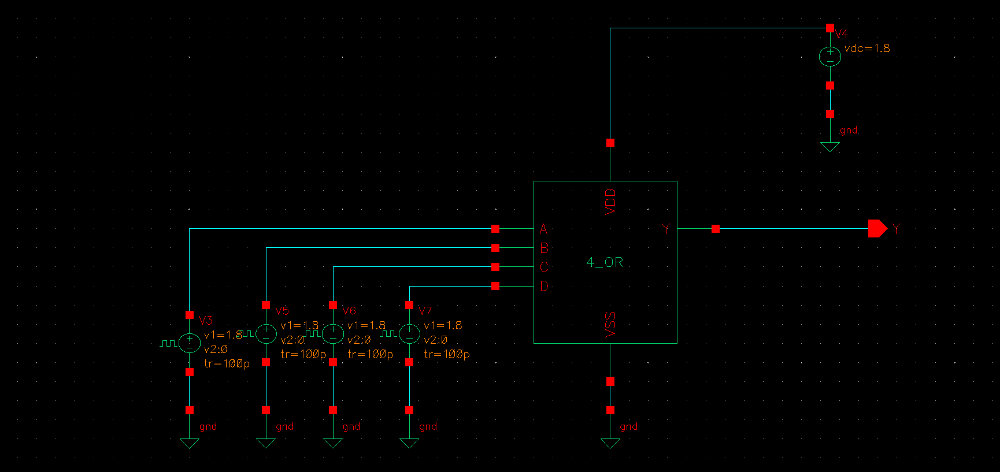 | 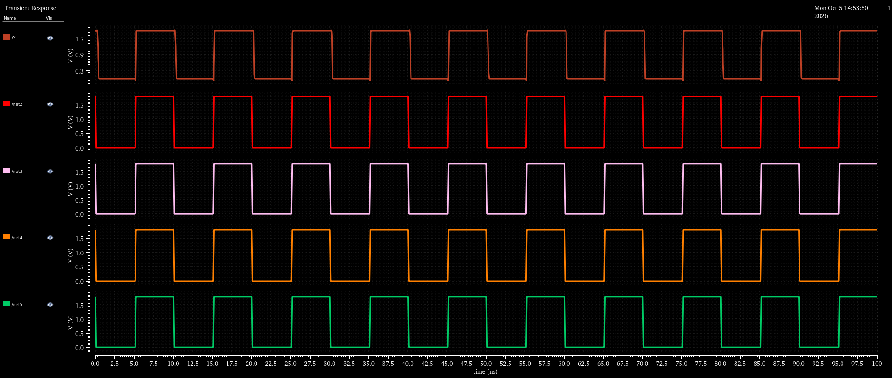 |

### 5-Input OR Gate Simulation
| Testbench Setup | Pre-Layout Transient Waveforms |
| :---: | :---: |
| 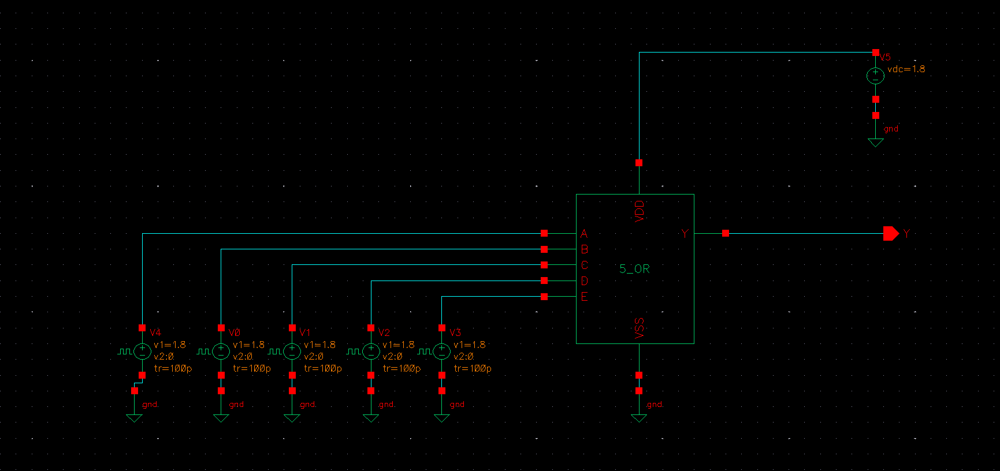 | 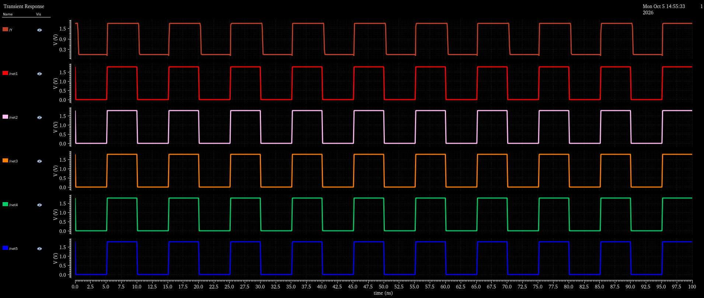 |

---

## 5. Verification Insights
* **Logic Completeness:** The transient waveforms confirm exact Boolean OR functionality across all input combinations: the output is low ($0\,\text{V}$) if and only if all inputs are low; any high input immediately transitions the output to $V_{DD}$.
* **Sizing Considerations:** For higher fan-in gates (4-input and 5-input OR), PMOS sizing was scaled proportionally to mitigate the high effective resistance of long series-connected PMOS chains.
