# CMOS AND Gate Library (2-Input, 3-Input, 4-Input, 5-Input)

## 1. Overview
This module implements a standard-cell library of multi-input CMOS AND gates (2-input, 3-input, 4-input, and 5-input) in **Cadence Virtuoso**. In static complementary CMOS design, an AND gate is built by combining a **NAND stage** (parallel PMOS pull-up network, series NMOS pull-down network) with an inverting buffer stage.

These gates constitute the product-term generators within the **4-Bit Carry Look-Ahead Adder (CLA)**, computing the generate terms ($G_i = A_i \cdot B_i$) and higher-order propagated carry terms ($P_i P_{i-1} \dots C_{in}$).

---

## 2. Gate Topologies & Mathematical Formulation

| Gate | Boolean Equation | Pull-Down NMOS Network | Pull-Up PMOS Network | Inverter Stage |
| :--- | :--- | :--- | :--- | :--- |
| **2-Input AND** | $Y = A \cdot B$ | 2 NMOS in series | 2 PMOS in parallel | CMOS Inverter |
| **3-Input AND** | $Y = A \cdot B \cdot C$ | 3 NMOS in series | 3 PMOS in parallel | CMOS Inverter |
| **4-Input AND** | $Y = A \cdot B \cdot C \cdot D$ | 4 NMOS in series | 4 PMOS in parallel | CMOS Inverter |
| **5-Input AND** | $Y = A \cdot B \cdot C \cdot D \cdot E$ | 5 NMOS in series | 5 PMOS in parallel | CMOS Inverter |

---

## 3. Circuit Schematics & Symbols

### 2-Input AND Gate
| Transistor Schematic | Symbol View |
| :---: | :---: |
| 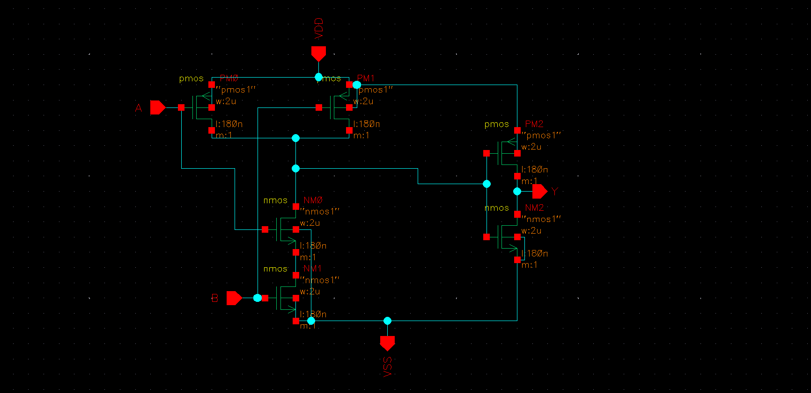 | 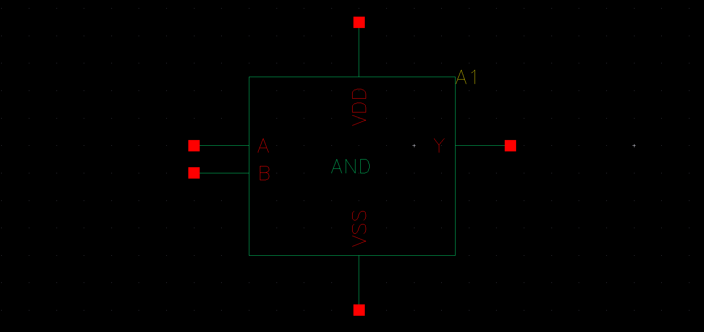 |

### 3-Input AND Gate
| Transistor Schematic | Symbol View |
| :---: | :---: |
| 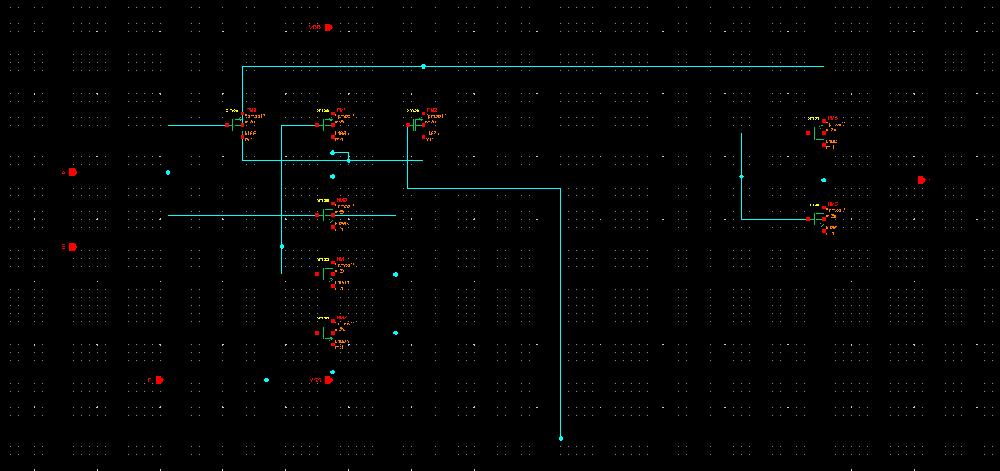 | 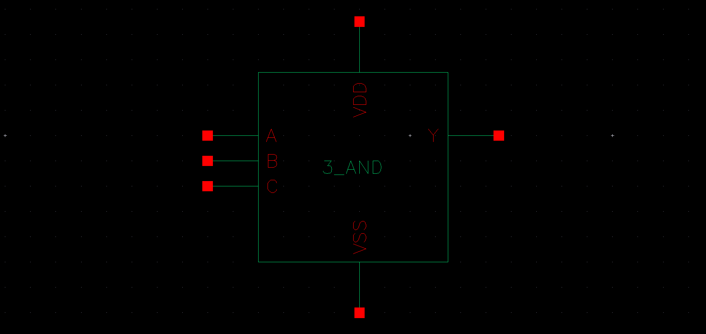 |

### 4-Input AND Gate
| Transistor Schematic | Symbol View |
| :---: | :---: |
| 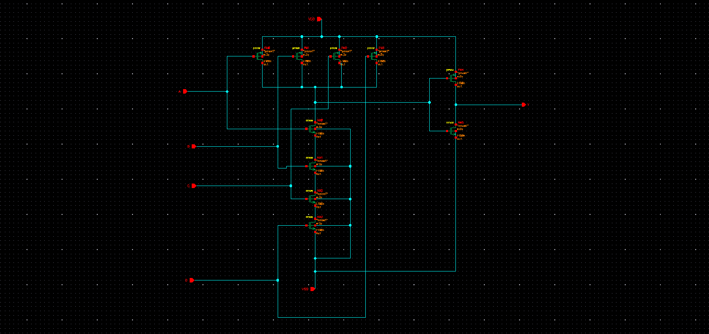 | 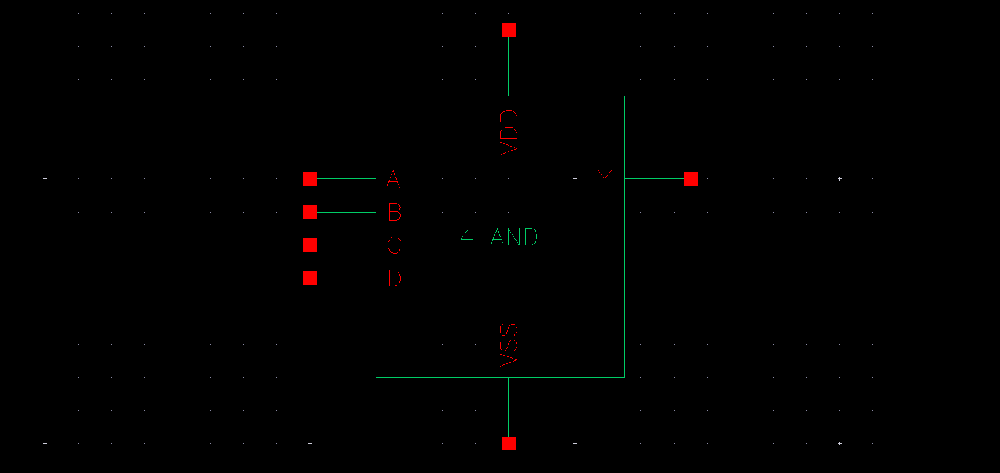 |

### 5-Input AND Gate
| Transistor Schematic | Symbol View |
| :---: | :---: |
| 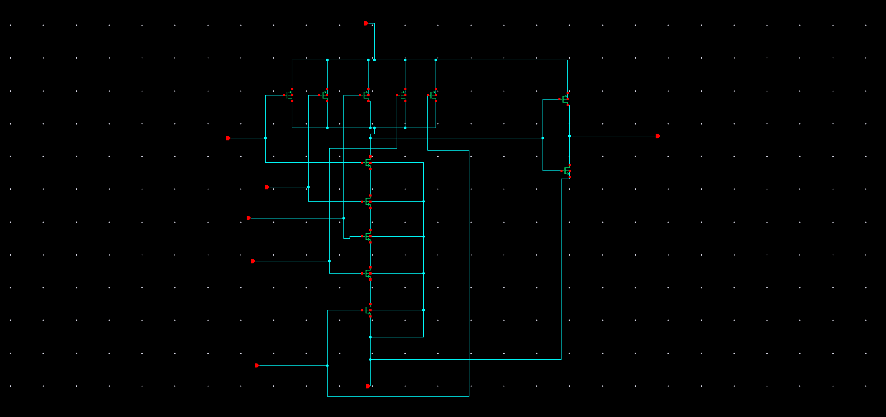 | 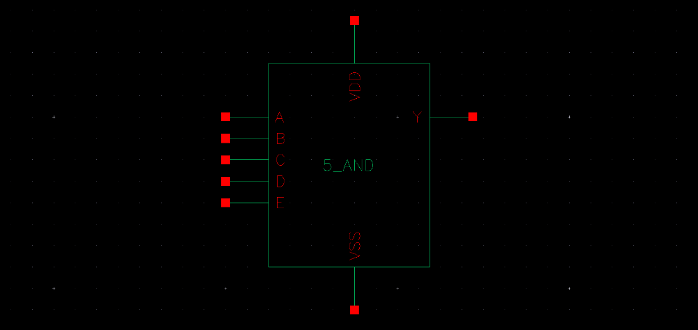 |

---

## 4. Testbenches & Simulation Waveforms

Each AND gate configuration was verified through transient simulation in Spectre using dynamic testbench stimuli.

### 2-Input AND Gate Simulation
| Testbench Setup | Pre-Layout Transient Waveforms |
| :---: | :---: |
| 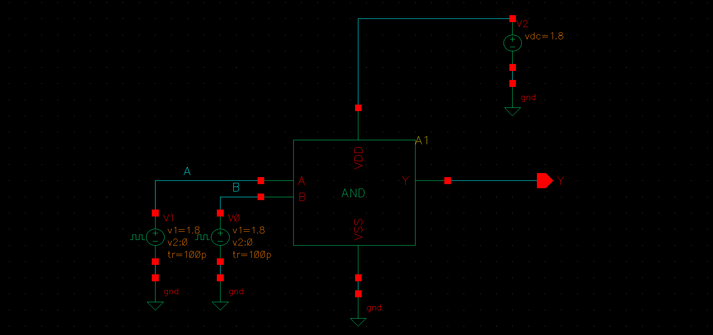 | 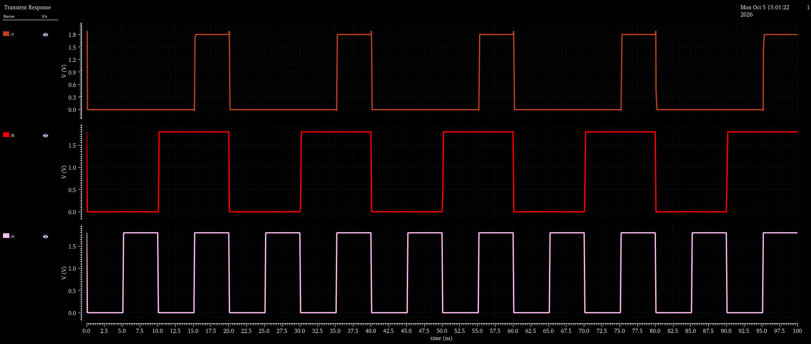 |

### 3-Input AND Gate Simulation
| Testbench Setup | Pre-Layout Transient Waveforms |
| :---: | :---: |
| 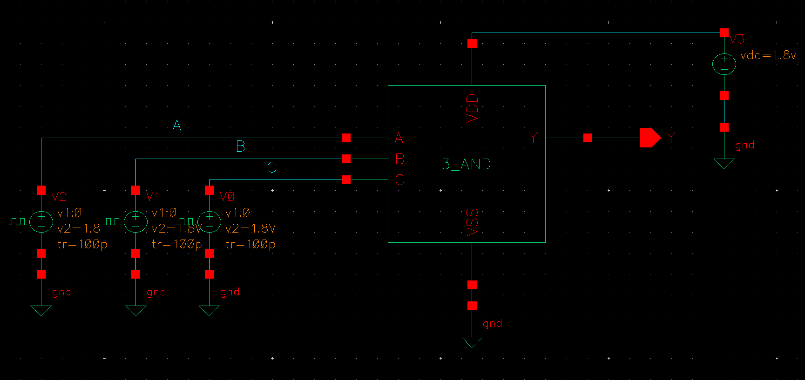 | 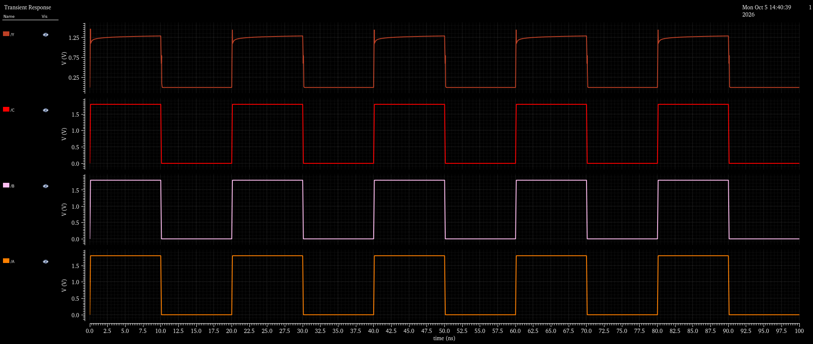 |

### 4-Input AND Gate Simulation
| Testbench Setup | Pre-Layout Transient Waveforms |
| :---: | :---: |
| 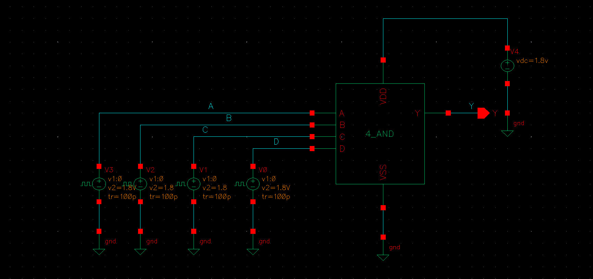 | 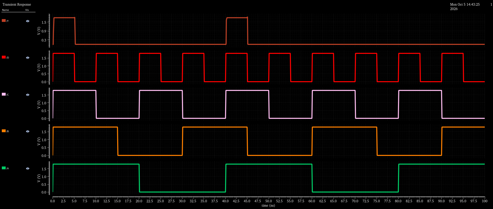 |

### 5-Input AND Gate Simulation
| Testbench Setup | Pre-Layout Transient Waveforms |
| :---: | :---: |
| 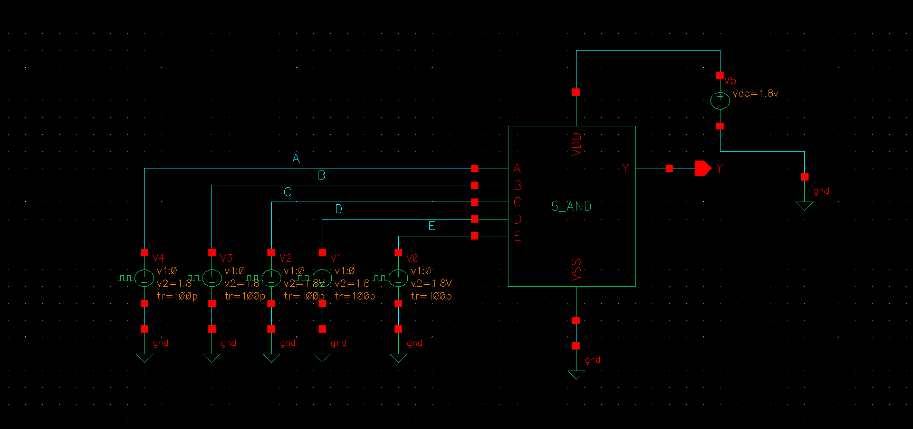 | 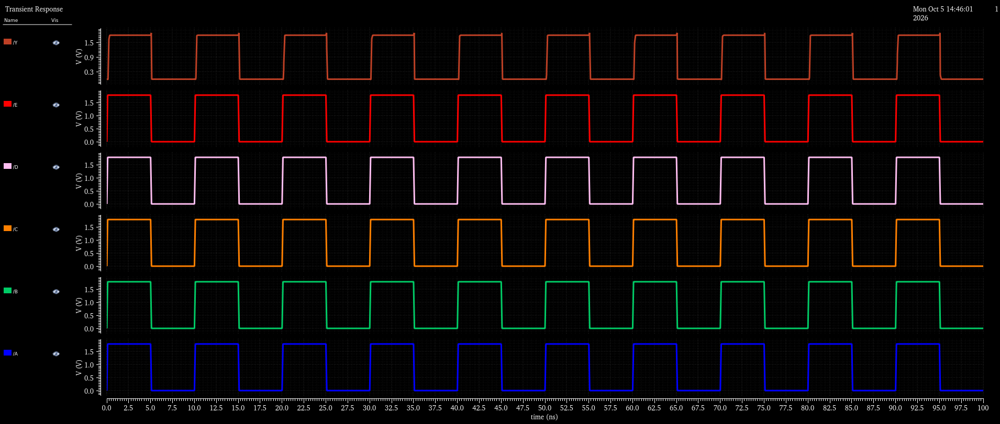 |

---

## 5. Verification Insights
* **Conducted Validation:** The output stays at logic low ($0\,\text{V}$) for all input combinations until all simultaneous inputs transition high ($V_{DD}$), driving the output to logic high.
* **Stacking Effects:** In higher fan-in AND cells (AND4, AND5), the series stack of NMOS transistors increases the effective pull-down path resistance. Proper $W/L$ channel width scaling preserves adequate discharge speed and maintains symmetrical switching thresholds.
