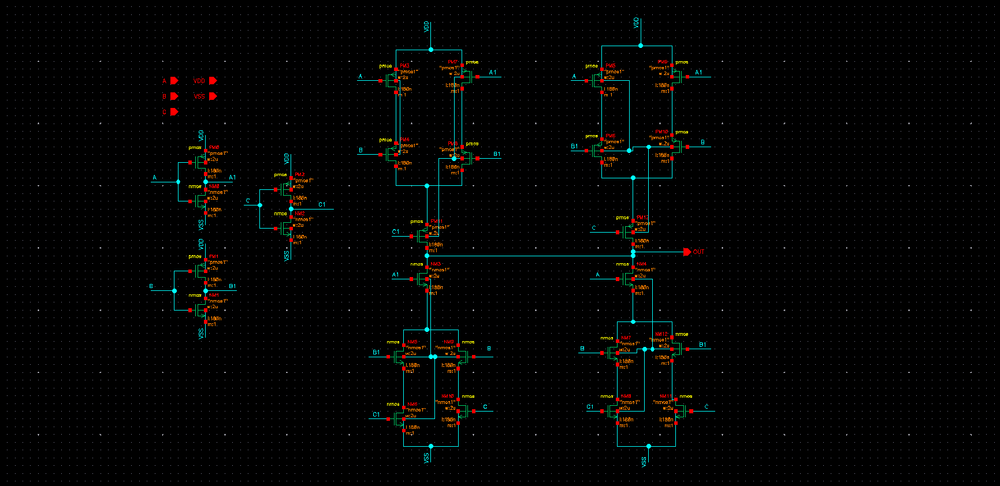
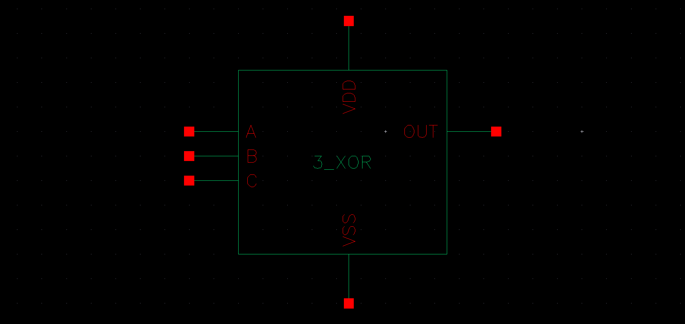
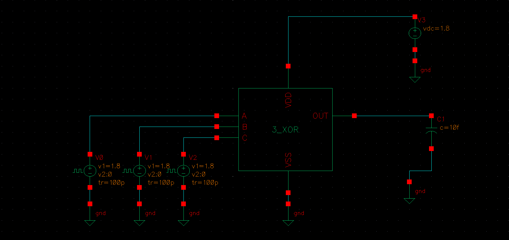
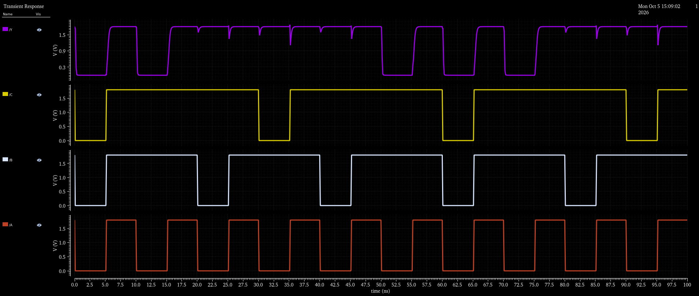

# CMOS 3-Input XOR Gate Library

## 1. Overview
The **3-Input XOR Gate** is an essential arithmetic component utilized in the **4-Bit Carry Look-Ahead Adder (CLA)** to calculate the full sum bits:

$$S_i = A_i \oplus B_i \oplus C_i$$

In binary arithmetic, a 3-input XOR acts as an odd parity generator: the output $Y$ is high ($1$) whenever an odd number of inputs are high ($1$).

---

## 2. Boolean Formulation & Truth Table

$$Y = A \oplus B \oplus C = (A \cdot \overline{B} \cdot \overline{C}) + (\overline{A} \cdot B \cdot \overline{C}) + (\overline{A} \cdot \overline{B} \cdot C) + (A \cdot B \cdot C)$$

| $A$ | $B$ | $C$ | $Y = A \oplus B \oplus C$ |
| :-: | :-: | :-: | :---: |
| 0 | 0 | 0 | **0** |
| 0 | 0 | 1 | **1** |
| 0 | 1 | 0 | **1** |
| 0 | 1 | 1 | **0** |
| 1 | 0 | 0 | **1** |
| 1 | 0 | 1 | **0** |
| 1 | 1 | 0 | **0** |
| 1 | 1 | 1 | **1** |

---

## 3. Circuit Schematic & Symbol

| Transistor-Level Schematic | Symbol View |
| :---: | :---: |
|  |  |

---

## 4. Testbench & Simulation Results

The cell was simulated in Cadence Virtuoso Spectre using three distinct pulse train inputs with differing periods to exercise all eight input combinations.

| Testbench Circuit | Pre-Layout Transient Simulation Waveforms |
| :---: | :---: |
|  |  |

---

## 5. Circuit Design Notes
* **Odd Parity Response:** Output cleanly transitions to $V_{DD}$ whenever 1 or 3 inputs are high, and pulls down to $0\,\text{V}$ whenever 0 or 2 inputs are high.
* **Balanced Paths:** Symmetry in transistor sizing ensures balanced propagation delay regardless of which input transitions last, preventing false glitches in the downstream carry lookahead logic.
